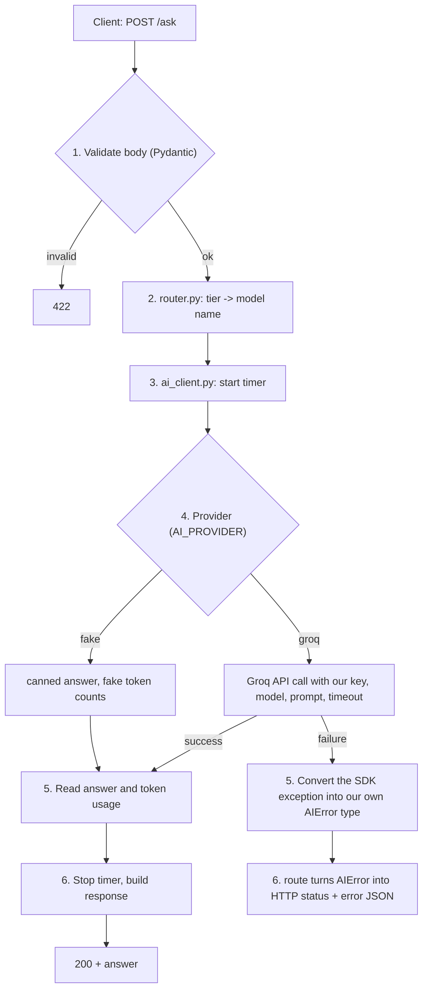

# Learning

Filled in as we go. Each part has the same sections:

- **The flow**: what happens, step by step, when a request comes in
- **Where it lives in the code**: file → responsibility
- **Concepts**: short explanations in plain words
- **Gotchas**: things that broke or surprised us
- **Your questions**: questions you asked during the part, with the answers
- **Interview questions**: 10–15 at the end of the part. Answer each one out loud in under 90 seconds, then tick it.

---

## Part 1: AI API server

### FastAPI in 10 minutes (quick revision)

FastAPI is a Python web framework. You write normal functions; it turns them into HTTP endpoints.

| Piece | What it is | Example in our code |
|---|---|---|
| `app = FastAPI()` | The application object. Everything attaches to it. | [app/main.py](app/main.py) |
| Route decorator | `@app.get("/health")` links an HTTP method + path to a function. Also `@app.post`, etc. | `health()` |
| Return value | Return a dict or a model; FastAPI converts it to JSON with status 200. | `{"status": "ok"}` |
| Pydantic model | A class describing the shape of a request or response body. FastAPI validates incoming JSON against it and returns **422** if it doesn't match. | `AskRequest` (step 1.3) |
| `response_model` | Filters and documents what we send back, so extra or secret fields never leak. | step 1.3 |
| `HTTPException` | Raise it to return an error status + JSON body (e.g. 502, 504). | step 1.4 |
| Dependency injection | `Depends(...)` lets FastAPI supply shared things (settings, the AI client) to a route. Easy to swap in tests. | step 1.2/1.3 |
| `def` vs `async def` | `def` runs in a thread pool; `async def` runs on the event loop and must never block (no slow sync calls inside it). | decided in step 1.3 |
| Auto docs | `/docs` (Swagger UI) is generated from your routes and models. | open `localhost:8000/docs` |
| Server | FastAPI only defines the app. **uvicorn** is the server process that listens on a port and runs it. | `uvicorn app.main:app` |
| Testing | `TestClient(app)` calls the app in-process, with no real server needed. | [tests/test_health.py](tests/test_health.py) |

### How to create a FastAPI project (manual vs commands)

**FastAPI has no project generator.** There is no `django-admin startproject` and no `manage.py`. A FastAPI project is just Python files, so doing it by hand is the normal way, and it is exactly what we did in step 1.1.

Django vs FastAPI:

| | Django | FastAPI |
|---|---|---|
| Create project | `django-admin startproject` generates a fixed layout | You create the folders and files yourself |
| Structure | Imposed by the framework | Your choice |
| Run | `python manage.py runserver` | `uvicorn app.main:app --reload` |
| Included | ORM, admin, auth, templates | Routing, validation, docs. Everything else you add |

Steps (what we did):
1. `python3 -m venv .venv` then `source .venv/bin/activate`: an isolated environment.
2. `pip install fastapi "uvicorn[standard]"`, then `pip freeze` or a hand-written `requirements.txt`.
3. Create the `app/` folder with an empty `__init__.py` (it makes `app` an importable package).
4. Create `app/main.py` containing `app = FastAPI()` and at least one route.
5. Run `uvicorn app.main:app --reload`. Read it as `uvicorn <module path>:<variable name>`: file `app/main.py`, variable `app`.
6. Open `/docs` to try the routes.

**Can you run it with `python main.py`?** Yes. Add this at the bottom of `main.py`:
```python
if __name__ == "__main__":
    import uvicorn
    uvicorn.run("app.main:app", reload=True)
```
That is the same uvicorn, started from Python. Running `uvicorn ...` from the terminal is more common, and it lets you pass `--port` and `--workers` without editing code.

There is also an official `fastapi` command (`fastapi dev app/main.py`) that wraps uvicorn. It is a convenience, not a project generator.

Growing structure (we add these only when needed):
```
app/
  main.py      # creates the app, includes routers
  config.py    # settings
  router.py    # model routing
  ai_client.py # the only file that talks to the AI API
  routes/      # (later) one file per group of endpoints, using APIRouter
```

### Model routing: light vs heavy

Real AI products rarely send every request to the biggest model. Big models are slower, cost more, and hit rate limits sooner. So the server picks a **tier** per job:

| Tier | Model (Groq) | Use for | Trade-off |
|---|---|---|---|
| light | `openai/gpt-oss-20b` | Classification, short answers, simple extraction | Fast, cheap, weaker reasoning |
| heavy | `openai/gpt-oss-120b` | Multi-step reasoning, long answers | Slower, more expensive, better quality |

Where it lives: `router.py` has one small function, `tier -> model name`, reading `AI_MODEL_LIGHT` and `AI_MODEL_HEAVY` from `.env`. The route calls the router and passes the chosen model to `ai_client.py`. The client stays the same; only the model argument changes. This is the "one client, model per call" idea from above. In Part 2 every metric gets a `tier` label, so in Grafana we can compare latency, errors and cost of light vs heavy.

### uvicorn, the entry point, and routing

#### What is uvicorn?
FastAPI **cannot talk to the network by itself**. It never opens a port or reads raw bytes from a socket. It only knows: "given a request, call the right function and build a response". **uvicorn is the web server** that does the network part.

| Layer | Job | Who |
|---|---|---|
| Network | Open port 8000, accept TCP connections, read the HTTP text, write the HTTP reply | **uvicorn** |
| Framework | Find the matching route, validate input, call your function, build the response | **FastAPI** (built on Starlette) |
| Your code | The business logic | `health()`, later `ask()` |

How they connect: a standard called **ASGI**. It says an app is a callable `app(scope, receive, send)`. uvicorn turns each HTTP request into those three things and calls your `app` object. FastAPI's `app` *is* that callable. (The older standard, WSGI, is what Flask and classic Django use. ASGI adds async support.)

Request path for `GET /health`:
```
curl -> TCP :8000 -> uvicorn (parses HTTP) -> app(scope, receive, send)
     -> FastAPI router matches GET /health -> health() runs
     -> dict becomes JSON -> uvicorn writes the HTTP response -> curl
```

Useful flags:
| Command | Meaning |
|---|---|
| `uvicorn app.main:app` | Run it on `127.0.0.1:8000` |
| `--reload` | Restart when code changes. **Development only** |
| `--port 9000` / `--host 0.0.0.0` | Change the port / accept connections from outside (needed in Docker) |
| `--workers 4` | 4 processes, to use several CPU cores. Production, not combined with `--reload` |

Why Prometheus cares later: uvicorn runs our process, and Prometheus will scrape `/metrics` from that same process. With several workers, each worker has its own counters. We will keep one worker in this project.

#### The entry point
The entry point is **the `app` object**, not a file you "run". The string `app.main:app` means *module path* `app/main.py`, then *variable* `app`. That is how uvicorn knows where to start.

```
uvicorn app.main:app
        |        |
        |        +-- the variable `app = FastAPI()`
        +----------- the file app/main.py (folder app/, file main)
```
Two things to remember:
- `app/__init__.py` makes `app` a package, so `app.main` can be imported.
- Python files are imported by their dotted path from the project root, so run uvicorn **from the project root**.

#### Routing across several files (`APIRouter`)
One file with every route gets messy. `APIRouter` is a mini-app: you define routes in separate files, and `main.py` plugs them in.

```
app/
  main.py          # creates the app, includes the routers
  routes/
    __init__.py
    health.py      # router with GET /health
    ask.py         # router with POST /ask, GET /ask/{job_id}
```

`app/routes/health.py`
```python
from fastapi import APIRouter

router = APIRouter(tags=["health"])


@router.get("/health")
def health():
    return {"status": "ok"}
```

`app/routes/ask.py`
```python
from fastapi import APIRouter

router = APIRouter(prefix="/ask", tags=["ask"])


@router.post("")                 # POST /ask
def ask(): ...


@router.get("/{job_id}")         # GET /ask/7 (job_id is a path parameter)
def get_job(job_id: int): ...
```

`app/main.py`
```python
from fastapi import FastAPI
from app.routes import ask, health

app = FastAPI(title="AI API Server")
app.include_router(health.router)     # plug each router in
app.include_router(ask.router)
```

#### `prefix` and `tags` in detail

```python
router = APIRouter(prefix="/ask", tags=["ask"])
```

**`prefix`** is text added to the front of every route path in that router.

| Decorator in `ask.py` | Final URL |
|---|---|
| `@router.post("")` | `POST /ask` |
| `@router.get("/{job_id}")` | `GET /ask/7` |
| `@router.get("/stats")` | `GET /ask/stats` |

- Without it you would write `/ask` in every decorator, and renaming the group means editing every line.
- The prefix must start with `/` and must not end with `/`.
- You can also set it where you plug the router in: `app.include_router(ask.router, prefix="/api/v1")` makes the URL `/api/v1/ask`. This is the usual way to add API versions without touching the route files.
- It changes the real URL, so it affects routing.

**`tags`** is a label used only for documentation.

- FastAPI puts the tags into the OpenAPI schema, and `/docs` uses them to group endpoints under headings (`health`, `ask`).
- It does **not** change the URL, the behaviour, or the matching. Remove it and the API works exactly the same, but `/docs` shows one long list under `default`.
- It is a list, so one route can have several tags and appear under several headings.
- Set it on the router (all its routes), on `include_router(...)`, or on a single route: `@router.get("/x", tags=["admin"])`.

| | `prefix` | `tags` |
|---|---|---|
| Changes the URL | Yes | No |
| Affects which function runs | Yes | No |
| Shows in `/docs` | As part of each path | As group headings |
| Typical value | `"/ask"` | `["ask"]` |

Rules for how a request finds its route:
1. FastAPI matches on **method + path**. `GET /ask` and `POST /ask` are two different routes.
2. It checks routes **in the order they were registered, and the first match wins**. Put fixed paths (`/ask/stats`) before variable ones (`/ask/{job_id}`), or `stats` will be treated as a `job_id`.
3. `prefix` is added to every route in the router, so you do not repeat `/ask` in each decorator.
4. `tags` only group endpoints in `/docs`. They do not change behaviour.
5. Path parameters are typed. `GET /ask/x` with `job_id: int` returns **422**, not 404.
6. No match at all gives **404**. A known path with the wrong method gives **405**.

**Where we will use it:** when we add `/ask` (step 1.3) and `/metrics` (Part 2), each gets its own router file instead of growing `main.py`. I tested this exact layout in a scratch folder before writing it down.

### Business logic of `/ask` (design before coding)

> **Update 2026-11-08:** the endpoint now decides the tier, so there is no `tier` field in the request and no `auto`. `/ask` is replaced by `POST /classify` (light) and `POST /analyze` (heavy); `GET /ask/{job_id}` is deleted. The flow below is otherwise unchanged: validate, select model, call the provider with a timer, map result or error, respond. Read "ask" as "the job endpoint".

#### The job in one sentence
A client sends a prompt and a tier. Our server picks the model, calls the AI API with **our** key, and returns either the answer plus facts about the call, or a clear error that says what went wrong.

#### Contract (what goes in, what comes out)

`POST /ask`
```json
{ "prompt": "Explain what a counter metric is", "tier": "light" }
```
| Field | Rules |
|---|---|
| `prompt` | Required string, 1 to 4000 characters |
| `tier` | `"light"` or `"heavy"`, default `"light"` |

Success, **200**:
```json
{ "answer": "...", "tier": "light", "model": "openai/gpt-oss-20b",
  "usage": { "input_tokens": 18, "output_tokens": 120 }, "latency_ms": 640 }
```
Failure (same shape for every failure):
```json
{ "error": { "type": "rate_limited", "message": "The AI provider is limiting requests. Try again later." } }
```

#### The flow, step by step


1. **Validate.** FastAPI checks the body against a Pydantic model. Bad input returns 422 and never reaches the AI. This protects our free quota.
2. **Route to a model.** `router.py` turns the tier into a model name from `.env`. Unknown tiers are already rejected in step 1.
3. **Start the timer.** Latency is measured around the provider call only, so it reflects the AI API and not our validation.
4. **Call the provider.** Real mode calls Groq with the key, the model, the prompt, `max_completion_tokens` (we cap it, so one request cannot burn the quota) and a timeout. Fake mode returns a canned answer.
5. **Read the result.** On success: the answer text and `usage` (input and output tokens). On failure: convert the SDK exception into our own error type.
6. **Respond.** Stop the timer and return JSON. The route does the HTTP mapping, nothing else.

#### Who does what (layers)
| File | Knows about | Must NOT know about |
|---|---|---|
| `routes/ask.py` | HTTP: request model, status codes, error JSON | Groq, API keys |
| `router.py` | tier -> model name | HTTP, Groq |
| `ai_client.py` | Groq, key, timeout, token usage, fake mode | HTTP status codes |
| `config.py` | Reading `.env` | Everything else |

Why: swapping Groq for another provider changes **one file**. The route imports our `AIError` types, never `groq` itself. Tests replace `ai_client` without touching HTTP code.

#### Failure mapping (step 1.5)
The Groq SDK raises these exceptions. We turn each into one of our error types and one HTTP status:

| Groq SDK exception | What happened | Our `type` | HTTP status | Why this status |
|---|---|---|---|---|
| `APITimeoutError` | Groq did not answer in time | `timeout` | **504** Gateway Timeout | We are a gateway, upstream was too slow |
| `RateLimitError` (429) | Free quota hit | `rate_limited` | **429** | Client should slow down and retry later |
| `AuthenticationError` (401) | Our key is wrong or revoked | `auth_error` | **502** | Not the client's fault, **our** config is broken. Never return 401: the client's credentials are fine |
| `InternalServerError` (5xx), `APIConnectionError` | Groq is down or unreachable | `upstream_error` | **502** Bad Gateway | The upstream is broken |
| `BadRequestError` (400) | Our request was invalid (e.g. prompt too long for the model) | `bad_request` | **400** | The request needs changing |

**Trap:** `APITimeoutError` is a *subclass* of `APIConnectionError`. If you catch `APIConnectionError` first, timeouts are mislabelled. Always catch the most specific exception first.

Retries: the SDK already retries 2 times by default (429, 5xx, connection errors) with backoff. That hides retries inside the latency: a 30 s timeout with 2 retries can take about 90 s. We will set `max_retries` explicitly and keep the total time bounded.

#### Decisions
| Decision | Choice | Reason |
|---|---|---|
| Streaming | **No** (`stream=False`) | One simple JSON reply. Easier to measure latency and tokens. Streaming can be a later exercise |
| Sync or async | `async def` route with the `AsyncGroq` client | Waiting for an AI call is slow I/O. Async lets one process wait on many calls at once. This also makes the "in flight" gauge in Part 2 meaningful |
| Client lifetime | One client, created once at startup, reused | See "One client, reused" above |
| Prompt in logs | **Not logged** | Prompts can hold private data. Log tier, model, outcome, latency, tokens only |
| Key in responses or logs | **Never** | The key stays on the server. That is the whole point of the proxy |
| `GET /ask/{job_id}` | Not needed | `/ask` answers in the same request. A job id only makes sense for background jobs. Suggest deleting it for now |

#### Fake mode (so we can learn without quota)
- Returns `"[fake light] You asked: <prompt>"` with made-up token counts.
- Special prompts trigger failures on purpose: `__fail:timeout__`, `__fail:rate_limited__`, `__fail:auth__`, `__fail:upstream__`. This lets tests and the Part 3 traffic script produce **every** error type on demand, without waiting for Groq to fail.

#### Build order for step 1.2 to 1.6
1. `config.py`: read `.env`, refuse to start in `groq` mode without a key.
2. `schemas.py`: `AskRequest`, `AskResponse`, error model.
3. `router.py`: tier to model.
4. `ai_client.py`: fake mode first, then Groq. Check model names with `GET /models`.
5. `routes/ask.py`: wire it together.
6. Failure mapping, then tests for each failure in fake mode.

#### Who decides light or heavy, and why a separate file?

**Two different jobs hide inside "routing":**
1. **Choose the tier** (light or heavy): *the decision*. This is the part that can get smart.
2. **Turn the tier into a model name** (`light` -> `openai/gpt-oss-20b` from settings): *the lookup*. This part is trivial.

Ways to make the decision:

| Option | How | Good | Bad |
|---|---|---|---|
| A. Client chooses | Request field `tier` | Simplest. The caller knows the job | Callers can pick `heavy` for everything and burn the quota |
| B. Per endpoint or job type | e.g. `/classify` always light, `/analyze` always heavy | Most common in real products: the **job** decides, not the prompt | More routes |
| C. Server rules ("auto") | Prompt length, keywords | Client doesn't care | Length is a crude guess for difficulty |
| D. Classifier call | A light model rates difficulty first | Smarter | An extra call: more latency and cost |
| E. Cascade | Try light, escalate to heavy on failure or low quality | Saves money | Complex, slower in the bad case |

**Recommendation for this project:** `tier` is `"light"`, `"heavy"` or `"auto"` (default `auto`). Auto uses a tiny rule: long prompts (over about 500 characters) or reasoning words ("explain why", "step by step", "compare", "analyze") go heavy, everything else goes light. It is crude on purpose: we learn the pattern and can see in Grafana whether the rule sends too much to heavy. Rule of thumb: the explicit `light`/`heavy` options (A) stay available, and in a real system job type (B) usually beats guessing from the text.

**Important for Part 2:** the metric label `tier` must hold the **resolved** tier (light or heavy), never `auto`. A label of `auto` would tell us nothing about cost or speed.

**Why a separate file for this?** Honest answer: the lookup alone (3 lines) does not need one. The file earns its place because of the decision part:
- the rules will grow (keywords, length limits, maybe fallback from heavy to light when Groq returns 429);
- it is **pure logic with no HTTP and no Groq**, so it is trivial to unit-test with plain inputs;
- the route stays short and `ai_client.py` stays about talking to Groq.

**Name warning:** `router.py` is easy to confuse with FastAPI's `APIRouter` (our `routes/` folder). Better name: **`model_selector.py`** with `choose_tier(prompt, requested_tier)` and `model_for(tier, settings)`. If you prefer fewer files, put both functions inside `ai_client.py` for now and split later when the rules grow. Both are fine; the principle that matters is that **the route does not contain the rules**.

**Decision (2026-11-08): option B, one endpoint per job.**
- `POST /classify` always uses **light**. `POST /analyze` always uses **heavy**. The caller cannot override it, so nobody can burn the heavy quota by choosing it for everything.
- Each endpoint owns its job prompt and its token cap (classify: short; analyze: long), so each also has its own latency and cost profile. That is what we compare in Grafana.
- `model_selector.py` stays a separate file: it holds the job → tier → model mapping in one place, with no HTTP and no Groq, so it is easy to test. Adding a third job later (say `/summarize` on light) is one new route plus one line there.
- The metric label `tier` stays (light or heavy); the route label already tells us which endpoint.

### Step 1.1: skeleton and `/health`

#### The flow
1. You run `uvicorn app.main:app --reload`. uvicorn imports `app` from `app/main.py` and listens on port 8000.
2. `curl localhost:8000/health` sends `GET /health`.
3. uvicorn passes the request to FastAPI, which finds the route that matches `GET /health`.
4. FastAPI calls `health()`, converts the returned dict to JSON, and sends `200 {"status":"ok"}`.

#### Where it lives in the code
| File | Responsibility |
|---|---|
| [app/main.py](app/main.py) | The FastAPI app and routes |
| [tests/test_health.py](tests/test_health.py) | Calls `/health` with `TestClient` |
| [pytest.ini](pytest.ini) | Puts the project root on the import path so tests can `import app` |
| [requirements.txt](requirements.txt) | Dependencies, installed into `.venv/` |
| `.env` / [.env.example](.env.example) | Local settings and the key (`.env` is git-ignored) |

#### Run it
```bash
source .venv/bin/activate
uvicorn app.main:app --reload      # then open http://localhost:8000/docs
pytest                             # run the tests
```

### Step 1.2: config and secrets

#### The flow
1. At startup (or the first time a route asks), `get_settings()` builds a `Settings` object once.
2. pydantic-settings reads **environment variables first, then the `.env` file**. `AI_PROVIDER` fills `ai_provider`, and so on (names are case-insensitive).
3. Each value is converted and checked: `AI_TIMEOUT_SECONDS="30"` becomes the number `30.0`, `AI_PROVIDER` must be `fake` or `groq`.
4. A validator adds one business rule: if the provider is `groq` and the key is empty, **raise an error** and the server refuses to start. Failing loudly at startup is better than failing on the first user request.
5. `lru_cache` makes every later `get_settings()` call return the same object, so `.env` is read once.

#### Where it lives in the code
| File | Responsibility |
|---|---|
| [app/config.py](app/config.py) | `Settings` class and `get_settings()` |
| [tests/test_config.py](tests/test_config.py) | Defaults, missing key, hidden key, bad provider, number parsing |

#### Concepts
- **Config from the environment (12-factor style):** code is the same everywhere; only the environment differs (your laptop, CI, a server).
- **Precedence:** real environment variable beats `.env`. That is how a server or CI injects secrets without a file.
- **`SecretStr`:** printing or logging the settings shows `**********`, not the key. You must call `.get_secret_value()` on purpose to read it. This is cheap protection against leaking the key in a log.
- **`extra="ignore"`:** unknown lines in `.env` (such as the old `AI_MODEL`) do not crash the app.
- **Fail fast:** a bad config should stop the process at startup.
- **How to use it in a route later:** `settings: Settings = Depends(get_settings)`. Tests can replace it with `app.dependency_overrides`.

#### Gotchas
- Tests call `Settings(_env_file=None)` and clear the `AI_*` variables with `monkeypatch`. Otherwise your real `.env` (provider `groq`, real key) would leak into the tests and make them depend on your machine.
- **`config.py` "does not read `.env`":** `env_file=".env"` is relative to the folder you *launch from*. From the project root it worked. From any other folder pydantic-settings does not complain: the file is simply not found, and the **defaults silently win** (`fake`, no key). Fix: `ENV_FILE = Path(__file__).resolve().parent.parent / ".env"`, an absolute path anchored to the file's own location. Checked from `app/` and from `~`.
- Related traps when "`.env` is ignored": (1) a real environment variable with the same name beats `.env`; (2) `Settings()` does **not** fill `os.environ`, so `os.getenv("AI_API_KEY")` is `None` even though `settings.ai_api_key` works. Always read values through `get_settings()`; (3) typos in the name are silently ignored because of `extra="ignore"`.

### Custom 404 (route not found): backend or frontend?

It is the **backend's** job. The frontend cannot change what the API answers. A frontend may show its own "page not found" screen, but for an API the response itself must be a clean, predictable JSON error that any client (a browser app, a script, `curl`) can parse. If we do nothing, FastAPI returns `{"detail":"Not Found"}`, which does not match our error shape.

**Why the catch-all route (`@router.get("*")`) does not work**
1. `"*"` is not a wildcard in FastAPI. It is read as the literal path `*`, so `GET /nothing` still returned the default 404. (We tested it.)
2. Even a working catch-all would only catch `GET`. `POST /nothing` and `DELETE /nothing` would still hit the default.
3. It would answer **200** for a missing page. The status code must stay **404**.
4. It would show up in `/docs`, and in Part 2 it would pollute the metrics.
5. It returned a Python set (`{"..."}`), which cannot be turned into JSON.

**The right way: an exception handler**
When no route matches, FastAPI/Starlette raises an HTTP exception with status 404. A handler lets us decide what to send back.
```python
# app/errors.py
async def http_exception_handler(request, exc):
    return JSONResponse(status_code=exc.status_code,
                        content={"error": {"type": "not_found", "message": "..."}})

app.add_exception_handler(StarletteHTTPException, http_exception_handler)
```
- It works for every method and every path, and keeps the real 404 status.
- It also covers **405** (known path, wrong method) and any `raise HTTPException(...)` we write ourselves, so the whole API shares one error shape. Handle `StarletteHTTPException`, not FastAPI's subclass, or the router's own 404s would be missed.
- Still to unify later: **422** validation errors (`RequestValidationError`). We will do it in step 1.5 with the AI errors.
- Tests: [tests/test_errors.py](tests/test_errors.py).

### How `config.py` works end to end (and how `main.py` uses it)

#### What `config.py` makes
It turns "text lines in a file" into **one typed Python object** that the rest of the app asks for.

```
.env file ──┐
            ├─> pydantic-settings ─> convert + validate ─> Settings object ─> get_settings() ─> main.py / routes
real env ───┘   (env vars win)        ("30" -> 30.0,        (cached, one copy)
                                       bad provider -> error,
                                       groq + no key -> error)
```

| Piece in `config.py` | What it does |
|---|---|
| `ENV_FILE = Path(__file__)...parent.parent / ".env"` | Absolute path to the project's `.env`, whatever folder you start from |
| `class Settings(BaseSettings)` | Each field is one setting. Field `ai_provider` reads variable `AI_PROVIDER` (name match ignores case) |
| `model_config = SettingsConfigDict(env_file=ENV_FILE, extra="ignore")` | Where to read, and ignore unknown lines |
| Field types and defaults | `float` converts text to a number, `Literal["fake","groq"]` rejects anything else, the default is used when the variable is missing |
| `@model_validator` | Our own rule: provider `groq` needs a key |
| `get_settings()` + `@lru_cache` | Builds `Settings` the first time, then returns the **same object** every time |

Order of lookup for each field: real environment variable, then the `.env` file, then the default in the class.

#### How `main.py` reads it
`main.py` reads it in **two places**:

1. **At startup, to fail fast.** `lifespan` is code that runs once when uvicorn starts the app (before the first request) and once at shutdown (after `yield`). It calls `get_settings()`, so a bad config stops the server right there, with `Application startup failed. Exiting.` Before this change **nothing** read the config at startup, so a missing key would only have shown up on the first request. (We tested it with real uvicorn.)
2. **In routes and the AI client, to use the values.** Not written yet (step 1.3). The pattern:
```python
from fastapi import Depends
from app.config import Settings, get_settings

@router.post("")
async def ask(body: AskRequest, settings: Settings = Depends(get_settings)):
    model = settings.ai_model_light      # the route never reads .env itself
```
`Depends(get_settings)` makes FastAPI call the function (it returns the cached object) and pass the result in. In tests we swap it with `app.dependency_overrides[get_settings] = lambda: fake_settings`, with no `.env` needed.

Rules: **only `config.py` touches `.env`**. Everything else receives a `Settings` object. That is why `os.getenv(...)` appears nowhere in the project.

### Middleware (where is it configured, and when does it run?)

**Middleware is code that wraps every request**, running before the route and again after it. It is configured **in `main.py`, on the `app` object**: it is part of the app, not of uvicorn.

```python
@app.middleware("http")                       # simple way: a decorator
async def timing(request, call_next):
    start = time.perf_counter()               # 1. runs BEFORE the route
    response = await call_next(request)       # 2. hands the request on (next middleware, then the route)
    ms = (time.perf_counter() - start) * 1000 # 3. runs AFTER the route, on the way back
    response.headers["X-Process-Time-Ms"] = f"{ms:.0f}"
    return response

# or add a ready-made class (CORS, GZip, our own):
app.add_middleware(SomeMiddlewareClass, option=value)
```

**About your question "before it reaches uvicorn or the routes":** uvicorn is **first**. It receives the connection and parses the HTTP, then calls the app. Middleware sits **inside the app, after uvicorn and before the routes**:

```
client -> uvicorn -> [ middleware 2 -> middleware 1 -> exception handlers -> router -> ROUTE ] -> back out the same way
                      \_____________________ inside our `app` object ____________________/
```
- Middleware can **read or reject a request before any route runs**, and **change the response on its way out**.
- It is an onion: the **last one added is the outermost**. We tested two:

| Step | Order we observed for `GET /hi` |
|---|---|
| 1 | second, before |
| 2 | first, before |
| 3 | ROUTE runs |
| 4 | first, after |
| 5 | second, after |

- It also runs for **unknown routes**: `GET /missing` went through both middlewares and then returned the 404. That matters for Part 2: metrics in middleware count 404s too.
- **What it is used for:** timing, request ids, logging, CORS, compression, authentication checks, and in Part 2 the `http_requests_total` metric.
- **Middleware vs dependency (`Depends`):** middleware wraps *every* request without the route knowing. `Depends` is chosen per route and can hand a value into the function (like settings). Cross-cutting and global: middleware. Needs a value in this route: `Depends`.
- **Do not use blocking code in middleware** (same rule as `async def` routes).

### Swagger UI in our app

**There is nothing to install.** FastAPI builds Swagger UI from your code.

| URL | What it is |
|---|---|
| `/docs` | **Swagger UI**: interactive. Open a route, click **Try it out**, send a real request |
| `/redoc` | ReDoc: the same information as a read-only reference page |
| `/openapi.json` | The machine-readable **OpenAPI** description. Both pages above are drawn from it. Tools (Postman, client generators) can import it |

How it is generated: FastAPI reads our routes, their paths and methods, the Pydantic models, and the status codes, and writes them into `/openapi.json`. The docs can never be out of date because they come from the same code that runs.

What we configured in [app/main.py](app/main.py): `title`, `version`, a markdown `description`, and `openapi_tags` (a description for each tag, which is where `tags=["ask"]` pays off). In [app/routes/health.py](app/routes/health.py) we added a route `summary` and `description`.

Still to do in **step 1.7**, once `/ask` has real models: request and response examples, and the error responses (`responses={...}` for 400, 429, 502, 504), so Swagger shows what a failure looks like. Pydantic models drive it: `Field(description=..., examples=[...])` on each field.

**Built in, or embedded by us?** Built in. Two separate things:
- **OpenAPI** is a standard format for describing an API. FastAPI **generates** it from our code (`/openapi.json`). This is the real "documentation".
- **Swagger UI** is a separate open-source JavaScript app (from the Swagger/OpenAPI project) that draws OpenAPI as an interactive page. FastAPI does not contain its code: `/docs` returns a small HTML page, and that page loads `swagger-ui-bundle.js` and `swagger-ui.css` from `cdn.jsdelivr.net` (we checked the page source). So **`/docs` needs internet access in the browser**. Offline, the page is blank; the fix is to serve the files ourselves with `get_swagger_ui_html(...)` and static files. `/redoc` works the same way (also a CDN script).
- It is a **description of the contract**, not a monitor. It does not count calls or errors. Tracking real traffic is what Prometheus and Grafana do in Parts 2 and 3.

Note: Swagger UI is public here. Real services often disable it in production (`docs_url=None`) or protect it.

### What is Starlette?

**Starlette is the lightweight ASGI web toolkit that FastAPI is built on.** FastAPI is Starlette plus extra features on top.

| Layer | Provided by |
|---|---|
| Network server (port, HTTP parsing) | uvicorn |
| Routing, request/response objects, middleware, exception handling, `TestClient`, `JSONResponse`, `HTTPException` base | **Starlette** |
| Type-hint validation (Pydantic), dependency injection (`Depends`), automatic OpenAPI and Swagger UI | **FastAPI** (added on top) |

```
uvicorn -> FastAPI (class FastAPI(Starlette)) -> Starlette routing/middleware -> your function
```
- `FastAPI` literally subclasses `Starlette`. Everything Starlette can do, FastAPI can do.
- You already used it: `from fastapi.testclient import TestClient` is Starlette's test client; `from starlette.exceptions import HTTPException as StarletteHTTPException` is the 404/405 handler in `errors.py`.
- **Why `errors.py` imports from `starlette`, not `fastapi`:** FastAPI's `HTTPException` is a subclass of Starlette's. The router raises Starlette's version for unknown routes (404) and wrong methods (405). A handler registered for FastAPI's subclass would miss them. A handler for the **parent** catches both.
- **Middleware** (code that wraps every request, such as timing or metrics in Part 2) is also a Starlette feature.

### Sync vs async: what changes for a request and a response?

**From the client's side: nothing.** The same request goes in, the same JSON comes back, and one single request takes the same time. The difference is inside the server, in **what it does while waiting** for something slow, like our AI API call (maybe 1 to 5 seconds).

The waiter picture:
- **Sync (`def`)**: one waiter per table. FastAPI runs each `def` route in a thread from a pool (about 40 threads). While the AI call is slow, that thread just stands there. Request 41 has to wait for a free thread.
- **Async (`async def` + `await`)**: one waiter serves many tables. At every `await`, the route says "wake me up when the answer arrives" and the event loop immediately serves other requests.

| | `def` (sync) | `async def` + `await` |
|---|---|---|
| Who runs it | A thread from a pool (about 40) | The event loop, one thread |
| While waiting for the AI | The thread is stuck, doing nothing | The route pauses, others run |
| Limit on concurrent waits | About the thread count | Thousands |
| Needs | Any normal library | An async library (`AsyncGroq`, `httpx.AsyncClient`) |
| Best for | Blocking libraries, simple code | Waiting on the network (our case) |

**We measured it** (50 requests at the same time, each waiting 0.2 s, one uvicorn process):

| Route | Total time |
|---|---|
| `def` + `time.sleep` | 0.51 s |
| `async def` + `await asyncio.sleep` | 0.37 s |
| `async def` + `time.sleep` (**the trap**) | **10.11 s** |

- At 50 requests the gap between sync and async is small, because a thread pool of about 40 copes. It grows as concurrency grows and as threads run out.
- Async does **not** make one request faster, and it does not help CPU-heavy work.
- **The golden rule:** never call a blocking function (`time.sleep`, `requests.get`, the sync `Groq` client) inside `async def`. The event loop is one thread, so it freezes **every** request at once. Result: 50 x 0.2 s = 10 s, which is worse than plain `def`.
- Honest caveat for this project: Groq's free tier allows only about 30 requests a minute, so real throughput will be capped by Groq whichever style we use. We choose async because it is the correct habit for I/O-bound services, it makes the "in-flight requests" gauge in Part 2 meaningful, and we can show the difference in the dashboard.
- Practical rule: **`async def` + an async client**, or plain **`def` + a sync client**. Never mix an async route with a sync client.

### Concepts
- **Why a venv:** `.venv/` keeps this project's packages separate from the rest of your system.
- **Why `/health`:** a cheap endpoint that says "the process is up". Monitoring tools and Docker use it. It is a different thing from "the AI API works".
- **Key vs model:** the API key says *who you are*; the model says *which model answers*. They are separate settings in `.env`.
- **One client, reused:** the Groq client holds the key, the connection pool, the timeout and the retries, so it is created **once** at startup and reused. Model, `temperature` and `max_completion_tokens` are arguments to each call, so they can change per request. Change the key in `.env` and you restart the server.

### Gotchas
- `@router.get("*")` is not a catch-all in FastAPI (literal path `*`). Use an exception handler for 404.
- `APITimeoutError` is a subclass of `APIConnectionError`: catch the timeout first.
- `pytest` failed with `No module named 'app'` until `pytest.ini` added `pythonpath = .`. Pytest does not add the project root to the import path by default.
- `.env` values have no quotes and no spaces around `=`.

### Your questions
- **Q: Is Swagger built into FastAPI to track APIs and make interactive docs, or do we embed it ourselves?**
  A: Built in. FastAPI generates the OpenAPI description (`/openapi.json`) from our routes and models, and serves a small HTML page at `/docs` that loads the open-source Swagger UI from a CDN. It documents the API contract; it does not track live traffic (that is Prometheus in Part 2). See "Swagger UI in our app".
- **Q: Can the endpoint decide the model (`/classify` light, `/analyze` heavy)?**
  A: Yes, it is option B and now our decision. See "Who decides light or heavy".
- **Q: Based on what do we use light or heavy, and why do we need a file just for routing?**
  A: Options are client-chosen, per job type, server rules ("auto"), a classifier call, or a cascade. Recommended: `tier` = light | heavy | auto, with a crude length/keyword rule for auto, and the metric label always the resolved tier. A separate file is justified by the decision rules (they grow, and are pure and testable), not by the 3-line lookup; rename it `model_selector.py` to avoid confusion with FastAPI routers.
- **Q: Is Swagger in our application?**
  A: Yes, FastAPI includes it at `/docs` (also `/redoc` and `/openapi.json`). We added app metadata and tag descriptions; examples and error responses come in step 1.7.
- **Q: What does `config.py` do, how does it read `.env`, and how does `main.py` read it?**
  A: It builds one typed, validated `Settings` object from real env vars, then `.env`, then defaults. `main.py` calls `get_settings()` in `lifespan` at startup to fail fast; routes get it with `Depends(get_settings)` (step 1.3). Only `config.py` touches `.env`.
- **Q: Where are middlewares configured, and do they run before uvicorn or the routes?**
  A: In `main.py` on the `app` (`@app.middleware("http")` or `app.add_middleware`). uvicorn is first; middleware runs inside the app after uvicorn and before the routes, and again on the way out. Last added is outermost, and 404s pass through too.
- **Q: Why does `config.py` not read `.env`?**
  A: It did only when started from the project root. `env_file=".env"` is relative to the launch folder, and a missing file is silently ignored, so defaults won. Reproduced from `app/` and `~`, fixed with an absolute `ENV_FILE` path plus a test.
- **Q: What is Starlette?**
  A: The ASGI toolkit FastAPI is built on (routing, middleware, request/response, exceptions, test client). FastAPI adds Pydantic validation, `Depends`, and OpenAPI/Swagger.
- **Q: What is the difference between async and sync in a request and response?**
  A: None for the client. Inside the server, sync holds a thread while waiting for the AI, and async pauses the route so one thread serves many waiting requests. Measured: 50 concurrent 0.2 s requests took 0.51 s (sync), 0.37 s (async), and 10.11 s when a blocking call sat inside `async def`.
- **Q: How do I return a custom message for any route that does not exist? Is that the frontend's job?**
  A: It is the backend's job. Register an exception handler for `StarletteHTTPException` (see `app/errors.py`). A `GET "*"` route does not work: it is not a wildcard, only catches GET, and would answer 200.
- **Q: What is the business logic and flow of asking the AI, before coding?**
  A: See "Business logic of `/ask` (design before coding)": validate, route tier to model, call provider with timer, map result or error, respond. Layers keep Groq out of the route.
- **Q: What are `prefix` and `tags` in `APIRouter(prefix="/ask", tags=["ask"])`?**
  A: `prefix` is prepended to every path in that router (it changes the URL). `tags` is a documentation label that groups endpoints in `/docs` (it changes nothing else). See "`prefix` and `tags` in detail".
- **Q: What is uvicorn, what is the entry point, and how do routes work across files?**
  A: See "uvicorn, the entry point, and routing" above. Short version: uvicorn is the web server (network, ASGI), FastAPI is the framework (routing, validation), the entry point is the `app` object named in `app.main:app`, and `APIRouter` + `include_router` split routes across files.
- **Q: Do I create a new client every time I change the model or other settings?**
  A: No. Create the client once and reuse it. Model, temperature and token limits are per-call arguments. Only a new key (or timeout/retry settings on the client) needs a restart.

### Interview questions
_Added at the end of Part 1._

---

## Part 2: Prometheus monitoring

### The flow
_To be written._

### Where it lives in the code
_To be written._

### Concepts
_To be written._

### Gotchas
_To be written._

### Your questions
_None yet._

### Interview questions
_Added at the end of Part 2._

---

## Part 3: Grafana dashboard and insights

### The flow
_To be written._

### Where it lives in the code
_To be written._

### Concepts
_To be written._

### Dashboard insights (your findings)
_Written during step 3.6._

### Your questions
_None yet._

### Interview questions
_Added at the end of Part 3._
