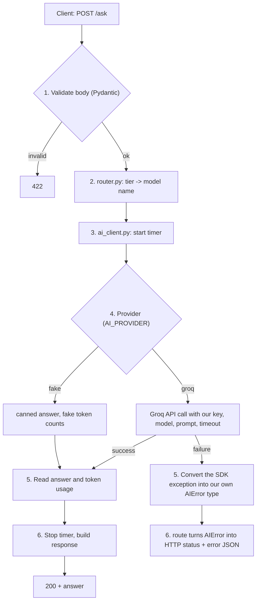

# Learning

Filled in as we go. Each part has the same sections:

- **The flow**: what happens, step by step, when a request comes in
- **Where it lives in the code**: file → responsibility
- **Concepts**: short explanations in plain words
- **Gotchas**: things that broke or surprised us
- **Your questions**: questions you asked during the part, with the answers
- **Interview questions**: 10–15 at the end of the part. Answer each one out loud in under 90 seconds, then tick it.

---

## Part 1: AI API server

### FastAPI in 10 minutes (quick revision)

FastAPI is a Python web framework. You write normal functions; it turns them into HTTP endpoints.

| Piece | What it is | Example in our code |
|---|---|---|
| `app = FastAPI()` | The application object. Everything attaches to it. | [app/main.py](app/main.py) |
| Route decorator | `@app.get("/health")` links an HTTP method + path to a function. Also `@app.post`, etc. | `health()` |
| Return value | Return a dict or a model; FastAPI converts it to JSON with status 200. | `{"status": "ok"}` |
| Pydantic model | A class describing the shape of a request or response body. FastAPI validates incoming JSON against it and returns **422** if it doesn't match. | `AskRequest` (step 1.3) |
| `response_model` | Filters and documents what we send back, so extra or secret fields never leak. | step 1.3 |
| `HTTPException` | Raise it to return an error status + JSON body (e.g. 502, 504). | step 1.4 |
| Dependency injection | `Depends(...)` lets FastAPI supply shared things (settings, the AI client) to a route. Easy to swap in tests. | step 1.2/1.3 |
| `def` vs `async def` | `def` runs in a thread pool; `async def` runs on the event loop and must never block (no slow sync calls inside it). | decided in step 1.3 |
| Auto docs | `/docs` (Swagger UI) is generated from your routes and models. | open `localhost:8000/docs` |
| Server | FastAPI only defines the app. **uvicorn** is the server process that listens on a port and runs it. | `uvicorn app.main:app` |
| Testing | `TestClient(app)` calls the app in-process, with no real server needed. | [tests/test_health.py](tests/test_health.py) |

### How to create a FastAPI project (manual vs commands)

**FastAPI has no project generator.** There is no `django-admin startproject` and no `manage.py`. A FastAPI project is just Python files, so doing it by hand is the normal way, and it is exactly what we did in step 1.1.

Django vs FastAPI:

| | Django | FastAPI |
|---|---|---|
| Create project | `django-admin startproject` generates a fixed layout | You create the folders and files yourself |
| Structure | Imposed by the framework | Your choice |
| Run | `python manage.py runserver` | `uvicorn app.main:app --reload` |
| Included | ORM, admin, auth, templates | Routing, validation, docs. Everything else you add |

Steps (what we did):
1. `python3 -m venv .venv` then `source .venv/bin/activate`: an isolated environment.
2. `pip install fastapi "uvicorn[standard]"`, then `pip freeze` or a hand-written `requirements.txt`.
3. Create the `app/` folder with an empty `__init__.py` (it makes `app` an importable package).
4. Create `app/main.py` containing `app = FastAPI()` and at least one route.
5. Run `uvicorn app.main:app --reload`. Read it as `uvicorn <module path>:<variable name>`: file `app/main.py`, variable `app`.
6. Open `/docs` to try the routes.

**Can you run it with `python main.py`?** Yes. Add this at the bottom of `main.py`:
```python
if __name__ == "__main__":
    import uvicorn
    uvicorn.run("app.main:app", reload=True)
```
That is the same uvicorn, started from Python. Running `uvicorn ...` from the terminal is more common, and it lets you pass `--port` and `--workers` without editing code.

There is also an official `fastapi` command (`fastapi dev app/main.py`) that wraps uvicorn. It is a convenience, not a project generator.

Growing structure (we add these only when needed):
```
app/
  main.py      # creates the app, includes routers
  config.py    # settings
  router.py    # model routing
  ai_client.py # the only file that talks to the AI API
  routes/      # (later) one file per group of endpoints, using APIRouter
```

### Model routing: light vs heavy

Real AI products rarely send every request to the biggest model. Big models are slower, cost more, and hit rate limits sooner. So the server picks a **tier** per job:

| Tier | Model (Groq) | Use for | Trade-off |
|---|---|---|---|
| light | `openai/gpt-oss-20b` | Classification, short answers, simple extraction | Fast, cheap, weaker reasoning |
| heavy | `openai/gpt-oss-120b` | Multi-step reasoning, long answers | Slower, more expensive, better quality |

Where it lives: `router.py` has one small function, `tier -> model name`, reading `AI_MODEL_LIGHT` and `AI_MODEL_HEAVY` from `.env`. The route calls the router and passes the chosen model to `ai_client.py`. The client stays the same; only the model argument changes. This is the "one client, model per call" idea from above. In Part 2 every metric gets a `tier` label, so in Grafana we can compare latency, errors and cost of light vs heavy.

### uvicorn, the entry point, and routing

#### What is uvicorn?
FastAPI **cannot talk to the network by itself**. It never opens a port or reads raw bytes from a socket. It only knows: "given a request, call the right function and build a response". **uvicorn is the web server** that does the network part.

| Layer | Job | Who |
|---|---|---|
| Network | Open port 8000, accept TCP connections, read the HTTP text, write the HTTP reply | **uvicorn** |
| Framework | Find the matching route, validate input, call your function, build the response | **FastAPI** (built on Starlette) |
| Your code | The business logic | `health()`, later `ask()` |

How they connect: a standard called **ASGI**. It says an app is a callable `app(scope, receive, send)`. uvicorn turns each HTTP request into those three things and calls your `app` object. FastAPI's `app` *is* that callable. (The older standard, WSGI, is what Flask and classic Django use. ASGI adds async support.)

Request path for `GET /health`:
```
curl -> TCP :8000 -> uvicorn (parses HTTP) -> app(scope, receive, send)
     -> FastAPI router matches GET /health -> health() runs
     -> dict becomes JSON -> uvicorn writes the HTTP response -> curl
```

Useful flags:
| Command | Meaning |
|---|---|
| `uvicorn app.main:app` | Run it on `127.0.0.1:8000` |
| `--reload` | Restart when code changes. **Development only** |
| `--port 9000` / `--host 0.0.0.0` | Change the port / accept connections from outside (needed in Docker) |
| `--workers 4` | 4 processes, to use several CPU cores. Production, not combined with `--reload` |

Why Prometheus cares later: uvicorn runs our process, and Prometheus will scrape `/metrics` from that same process. With several workers, each worker has its own counters. We will keep one worker in this project.

#### The entry point
The entry point is **the `app` object**, not a file you "run". The string `app.main:app` means *module path* `app/main.py`, then *variable* `app`. That is how uvicorn knows where to start.

```
uvicorn app.main:app
        |        |
        |        +-- the variable `app = FastAPI()`
        +----------- the file app/main.py (folder app/, file main)
```
Two things to remember:
- `app/__init__.py` makes `app` a package, so `app.main` can be imported.
- Python files are imported by their dotted path from the project root, so run uvicorn **from the project root**.

#### Routing across several files (`APIRouter`)
One file with every route gets messy. `APIRouter` is a mini-app: you define routes in separate files, and `main.py` plugs them in.

```
app/
  main.py          # creates the app, includes the routers
  routes/
    __init__.py
    health.py      # router with GET /health
    ask.py         # router with POST /ask, GET /ask/{job_id}
```

`app/routes/health.py`
```python
from fastapi import APIRouter

router = APIRouter(tags=["health"])


@router.get("/health")
def health():
    return {"status": "ok"}
```

`app/routes/ask.py`
```python
from fastapi import APIRouter

router = APIRouter(prefix="/ask", tags=["ask"])


@router.post("")                 # POST /ask
def ask(): ...


@router.get("/{job_id}")         # GET /ask/7 (job_id is a path parameter)
def get_job(job_id: int): ...
```

`app/main.py`
```python
from fastapi import FastAPI
from app.routes import ask, health

app = FastAPI(title="AI API Server")
app.include_router(health.router)     # plug each router in
app.include_router(ask.router)
```

#### `prefix` and `tags` in detail

```python
router = APIRouter(prefix="/ask", tags=["ask"])
```

**`prefix`** is text added to the front of every route path in that router.

| Decorator in `ask.py` | Final URL |
|---|---|
| `@router.post("")` | `POST /ask` |
| `@router.get("/{job_id}")` | `GET /ask/7` |
| `@router.get("/stats")` | `GET /ask/stats` |

- Without it you would write `/ask` in every decorator, and renaming the group means editing every line.
- The prefix must start with `/` and must not end with `/`.
- You can also set it where you plug the router in: `app.include_router(ask.router, prefix="/api/v1")` makes the URL `/api/v1/ask`. This is the usual way to add API versions without touching the route files.
- It changes the real URL, so it affects routing.

**`tags`** is a label used only for documentation.

- FastAPI puts the tags into the OpenAPI schema, and `/docs` uses them to group endpoints under headings (`health`, `ask`).
- It does **not** change the URL, the behaviour, or the matching. Remove it and the API works exactly the same, but `/docs` shows one long list under `default`.
- It is a list, so one route can have several tags and appear under several headings.
- Set it on the router (all its routes), on `include_router(...)`, or on a single route: `@router.get("/x", tags=["admin"])`.

| | `prefix` | `tags` |
|---|---|---|
| Changes the URL | Yes | No |
| Affects which function runs | Yes | No |
| Shows in `/docs` | As part of each path | As group headings |
| Typical value | `"/ask"` | `["ask"]` |

Rules for how a request finds its route:
1. FastAPI matches on **method + path**. `GET /ask` and `POST /ask` are two different routes.
2. It checks routes **in the order they were registered, and the first match wins**. Put fixed paths (`/ask/stats`) before variable ones (`/ask/{job_id}`), or `stats` will be treated as a `job_id`.
3. `prefix` is added to every route in the router, so you do not repeat `/ask` in each decorator.
4. `tags` only group endpoints in `/docs`. They do not change behaviour.
5. Path parameters are typed. `GET /ask/x` with `job_id: int` returns **422**, not 404.
6. No match at all gives **404**. A known path with the wrong method gives **405**.

**Where we will use it:** when we add `/ask` (step 1.3) and `/metrics` (Part 2), each gets its own router file instead of growing `main.py`. I tested this exact layout in a scratch folder before writing it down.

### Business logic of `/ask` (design before coding)

#### The job in one sentence
A client sends a prompt and a tier. Our server picks the model, calls the AI API with **our** key, and returns either the answer plus facts about the call, or a clear error that says what went wrong.

#### Contract (what goes in, what comes out)

`POST /ask`
```json
{ "prompt": "Explain what a counter metric is", "tier": "light" }
```
| Field | Rules |
|---|---|
| `prompt` | Required string, 1 to 4000 characters |
| `tier` | `"light"` or `"heavy"`, default `"light"` |

Success, **200**:
```json
{ "answer": "...", "tier": "light", "model": "openai/gpt-oss-20b",
  "usage": { "input_tokens": 18, "output_tokens": 120 }, "latency_ms": 640 }
```
Failure (same shape for every failure):
```json
{ "error": { "type": "rate_limited", "message": "The AI provider is limiting requests. Try again later." } }
```

#### The flow, step by step


1. **Validate.** FastAPI checks the body against a Pydantic model. Bad input returns 422 and never reaches the AI. This protects our free quota.
2. **Route to a model.** `router.py` turns the tier into a model name from `.env`. Unknown tiers are already rejected in step 1.
3. **Start the timer.** Latency is measured around the provider call only, so it reflects the AI API and not our validation.
4. **Call the provider.** Real mode calls Groq with the key, the model, the prompt, `max_completion_tokens` (we cap it, so one request cannot burn the quota) and a timeout. Fake mode returns a canned answer.
5. **Read the result.** On success: the answer text and `usage` (input and output tokens). On failure: convert the SDK exception into our own error type.
6. **Respond.** Stop the timer and return JSON. The route does the HTTP mapping, nothing else.

#### Who does what (layers)
| File | Knows about | Must NOT know about |
|---|---|---|
| `routes/ask.py` | HTTP: request model, status codes, error JSON | Groq, API keys |
| `router.py` | tier -> model name | HTTP, Groq |
| `ai_client.py` | Groq, key, timeout, token usage, fake mode | HTTP status codes |
| `config.py` | Reading `.env` | Everything else |

Why: swapping Groq for another provider changes **one file**. The route imports our `AIError` types, never `groq` itself. Tests replace `ai_client` without touching HTTP code.

#### Failure mapping (step 1.5)
The Groq SDK raises these exceptions. We turn each into one of our error types and one HTTP status:

| Groq SDK exception | What happened | Our `type` | HTTP status | Why this status |
|---|---|---|---|---|
| `APITimeoutError` | Groq did not answer in time | `timeout` | **504** Gateway Timeout | We are a gateway, upstream was too slow |
| `RateLimitError` (429) | Free quota hit | `rate_limited` | **429** | Client should slow down and retry later |
| `AuthenticationError` (401) | Our key is wrong or revoked | `auth_error` | **502** | Not the client's fault, **our** config is broken. Never return 401: the client's credentials are fine |
| `InternalServerError` (5xx), `APIConnectionError` | Groq is down or unreachable | `upstream_error` | **502** Bad Gateway | The upstream is broken |
| `BadRequestError` (400) | Our request was invalid (e.g. prompt too long for the model) | `bad_request` | **400** | The request needs changing |

**Trap:** `APITimeoutError` is a *subclass* of `APIConnectionError`. If you catch `APIConnectionError` first, timeouts are mislabelled. Always catch the most specific exception first.

Retries: the SDK already retries 2 times by default (429, 5xx, connection errors) with backoff. That hides retries inside the latency: a 30 s timeout with 2 retries can take about 90 s. We will set `max_retries` explicitly and keep the total time bounded.

#### Decisions
| Decision | Choice | Reason |
|---|---|---|
| Streaming | **No** (`stream=False`) | One simple JSON reply. Easier to measure latency and tokens. Streaming can be a later exercise |
| Sync or async | `async def` route with the `AsyncGroq` client | Waiting for an AI call is slow I/O. Async lets one process wait on many calls at once. This also makes the "in flight" gauge in Part 2 meaningful |
| Client lifetime | One client, created once at startup, reused | See "One client, reused" above |
| Prompt in logs | **Not logged** | Prompts can hold private data. Log tier, model, outcome, latency, tokens only |
| Key in responses or logs | **Never** | The key stays on the server. That is the whole point of the proxy |
| `GET /ask/{job_id}` | Not needed | `/ask` answers in the same request. A job id only makes sense for background jobs. Suggest deleting it for now |

#### Fake mode (so we can learn without quota)
- Returns `"[fake light] You asked: <prompt>"` with made-up token counts.
- Special prompts trigger failures on purpose: `__fail:timeout__`, `__fail:rate_limited__`, `__fail:auth__`, `__fail:upstream__`. This lets tests and the Part 3 traffic script produce **every** error type on demand, without waiting for Groq to fail.

#### Build order for step 1.2 to 1.6
1. `config.py`: read `.env`, refuse to start in `groq` mode without a key.
2. `schemas.py`: `AskRequest`, `AskResponse`, error model.
3. `router.py`: tier to model.
4. `ai_client.py`: fake mode first, then Groq. Check model names with `GET /models`.
5. `routes/ask.py`: wire it together.
6. Failure mapping, then tests for each failure in fake mode.

### Step 1.1: skeleton and `/health`

#### The flow
1. You run `uvicorn app.main:app --reload`. uvicorn imports `app` from `app/main.py` and listens on port 8000.
2. `curl localhost:8000/health` sends `GET /health`.
3. uvicorn passes the request to FastAPI, which finds the route that matches `GET /health`.
4. FastAPI calls `health()`, converts the returned dict to JSON, and sends `200 {"status":"ok"}`.

#### Where it lives in the code
| File | Responsibility |
|---|---|
| [app/main.py](app/main.py) | The FastAPI app and routes |
| [tests/test_health.py](tests/test_health.py) | Calls `/health` with `TestClient` |
| [pytest.ini](pytest.ini) | Puts the project root on the import path so tests can `import app` |
| [requirements.txt](requirements.txt) | Dependencies, installed into `.venv/` |
| `.env` / [.env.example](.env.example) | Local settings and the key (`.env` is git-ignored) |

#### Run it
```bash
source .venv/bin/activate
uvicorn app.main:app --reload      # then open http://localhost:8000/docs
pytest                             # run the tests
```

### Concepts
- **Why a venv:** `.venv/` keeps this project's packages separate from the rest of your system.
- **Why `/health`:** a cheap endpoint that says "the process is up". Monitoring tools and Docker use it. It is a different thing from "the AI API works".
- **Key vs model:** the API key says *who you are*; the model says *which model answers*. They are separate settings in `.env`.
- **One client, reused:** the Groq client holds the key, the connection pool, the timeout and the retries, so it is created **once** at startup and reused. Model, `temperature` and `max_completion_tokens` are arguments to each call, so they can change per request. Change the key in `.env` and you restart the server.

### Gotchas
- `pytest` failed with `No module named 'app'` until `pytest.ini` added `pythonpath = .`. Pytest does not add the project root to the import path by default.
- `.env` values have no quotes and no spaces around `=`.

### Your questions
- **Q: What is the business logic and flow of asking the AI, before coding?**
  A: See "Business logic of `/ask` (design before coding)": validate, route tier to model, call provider with timer, map result or error, respond. Layers keep Groq out of the route.
- **Q: What are `prefix` and `tags` in `APIRouter(prefix="/ask", tags=["ask"])`?**
  A: `prefix` is prepended to every path in that router (it changes the URL). `tags` is a documentation label that groups endpoints in `/docs` (it changes nothing else). See "`prefix` and `tags` in detail".
- **Q: What is uvicorn, what is the entry point, and how do routes work across files?**
  A: See "uvicorn, the entry point, and routing" above. Short version: uvicorn is the web server (network, ASGI), FastAPI is the framework (routing, validation), the entry point is the `app` object named in `app.main:app`, and `APIRouter` + `include_router` split routes across files.
- **Q: Do I create a new client every time I change the model or other settings?**
  A: No. Create the client once and reuse it. Model, temperature and token limits are per-call arguments. Only a new key (or timeout/retry settings on the client) needs a restart.

### Interview questions
_Added at the end of Part 1._

---

## Part 2: Prometheus monitoring

### The flow
_To be written._

### Where it lives in the code
_To be written._

### Concepts
_To be written._

### Gotchas
_To be written._

### Your questions
_None yet._

### Interview questions
_Added at the end of Part 2._

---

## Part 3: Grafana dashboard and insights

### The flow
_To be written._

### Where it lives in the code
_To be written._

### Concepts
_To be written._

### Dashboard insights (your findings)
_Written during step 3.6._

### Your questions
_None yet._

### Interview questions
_Added at the end of Part 3._
