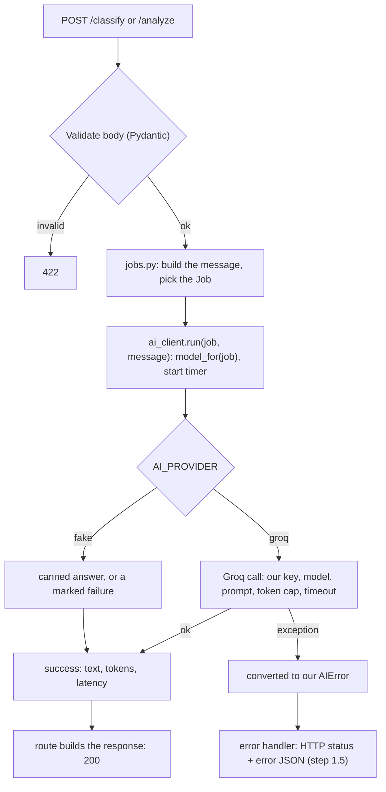

# Learning

Organised **by topic**, not by date. Each fact lives in one place; gotchas are marked ⚠ where they apply. Each part ends with a questions index and 10–15 interview questions (answer out loud in under 90 seconds, then tick them).

---

## Part 1: AI API server

Two job endpoints sit in front of the AI API: `POST /classify` (always the **light** model) and `POST /analyze` (always the **heavy** model). The server holds the API key; clients never see it.

### Code map

| File | Responsibility | Status |
|---|---|---|
| [app/main.py](app/main.py) | Creates the app, `lifespan` (startup/shutdown), Swagger metadata, includes routers | done |
| [app/config.py](app/config.py) | `Settings` from env and `.env`, `get_settings()` | done |
| [app/errors.py](app/errors.py) | One JSON error shape for 404 and 405 | done |
| [app/routes/health.py](app/routes/health.py) | `GET /health` | done |
| [app/routes/classify.py](app/routes/classify.py), [analyze.py](app/routes/analyze.py) | HTTP only: validate, call the client, build the response | stubs, you are writing them |
| [app/schemas.py](app/schemas.py) | Request/response models (drive validation and Swagger) | done |
| [app/jobs.py](app/jobs.py) | What each job is: tier, prompt, limits; message builders; `pick_label` | done |
| [app/ai_client.py](app/ai_client.py) | The only file that imports Groq; fake mode; error conversion | done |
| [app/ai_errors.py](app/ai_errors.py) | Our own AI error types | done |
| `tests/`, [pytest.ini](pytest.ini), [requirements.txt](requirements.txt), [.env.example](.env.example) | Tests (run in fake mode), pytest config, dependencies, settings template | done |

---

### 1. How a request travels

```
client -> uvicorn -> [ middleware -> exception handlers -> router -> ROUTE ] -> back out the same way
                      \________ inside our `app` object (FastAPI = Starlette + extras) ________/
```

| Layer | Job | Provided by |
|---|---|---|
| Network | Open the port, parse HTTP, write the reply | **uvicorn** |
| Web toolkit | Routing, middleware, exception handling, request/response objects, `TestClient` | **Starlette** |
| API framework | Pydantic validation, `Depends`, automatic OpenAPI and Swagger | **FastAPI** (a subclass of Starlette) |
| Our code | The business logic | routes, `jobs.py`, `ai_client.py` |

#### uvicorn and ASGI
FastAPI cannot talk to the network. uvicorn does, then calls our `app` through **ASGI**: an app is a callable `app(scope, receive, send)`. (WSGI, used by Flask and classic Django, is the older standard without async.)

| Command | Meaning |
|---|---|
| `uvicorn app.main:app` | Serve on `127.0.0.1:8000` |
| `--reload` | Restart on code changes (development only) |
| `--host 0.0.0.0` / `--port 9000` | Accept outside connections (needed in Docker) / change port |
| `--workers 4` | Several processes (production). Each worker has its own metric counters, so Part 2 uses one worker |

#### The entry point
It is the **`app` object**, not a file you run. `app.main:app` means file `app/main.py`, variable `app`. Run uvicorn **from the project root**, and keep `app/__init__.py` so `app` is an importable package.

#### Starlette
`class FastAPI(Starlette)`. We already use it: `TestClient`, and `StarletteHTTPException` in `errors.py`. We import the handler's exception from `starlette`, not `fastapi`, because the router raises Starlette's version for unknown routes (404) and wrong methods (405). FastAPI's `HTTPException` is a subclass, so a handler registered for the subclass would miss them; one registered for the parent catches both.

#### Middleware
Code that wraps **every** request: before the route on the way in, after it on the way out. Configured **in `main.py` on the `app`**, not in uvicorn:
```python
@app.middleware("http")
async def timing(request, call_next):
    start = time.perf_counter()             # before the route
    response = await call_next(request)     # next middleware, then the route
    response.headers["X-Time-Ms"] = f"{(time.perf_counter() - start) * 1000:.0f}"
    return response                         # after the route
```
- uvicorn comes first; middleware runs inside the app, after uvicorn and before the routes.
- It is an onion: the **last one added is the outermost**. We tested two: second-before, first-before, ROUTE, first-after, second-after.
- It also runs for unknown routes (`GET /missing` passed through both, then returned 404), so Part 2's middleware metrics will count 404s.
- Middleware vs `Depends`: middleware is global and invisible to the route (timing, logging, CORS, metrics). `Depends` is chosen per route and hands a value into the function (settings, the AI client).
- Never put blocking code in middleware (same rule as `async def`).

---

### 2. FastAPI building blocks

| Piece | What it is | In our code |
|---|---|---|
| `app = FastAPI()` | The application object | `main.py` |
| Route decorator | Links method + path to a function (`@router.post("/classify")`) | `routes/` |
| Pydantic model | Describes a body; invalid input returns **422** | `ClassifyRequest` |
| `response_model` | Filters and documents the output so extra or secret fields never leak | step 1.4 |
| `HTTPException` / handlers | Return an error status and JSON body | `errors.py` |
| `Depends(...)` | FastAPI supplies shared things to a route; easy to override in tests | `get_settings`, `get_ai_client` |
| `lifespan` | Code that runs once at startup and once at shutdown | `main.py` |
| `TestClient(app)` | Calls the app in-process, no server needed | `tests/` |

#### Creating a project: no generator
FastAPI has no `django-admin startproject` or `manage.py`. A project is plain Python files:
1. `python3 -m venv .venv && source .venv/bin/activate`
2. `pip install fastapi "uvicorn[standard]"`, then list dependencies in `requirements.txt`.
3. Create `app/` with an empty `__init__.py`, and `app/main.py` with `app = FastAPI()` plus a route.
4. `uvicorn app.main:app --reload`, then open `/docs`.

`python main.py` also works if `main.py` ends with `if __name__ == "__main__": uvicorn.run("app.main:app", reload=True)`; it is the same uvicorn. `fastapi dev app/main.py` is a convenience wrapper, not a generator.

#### Routers across files
Each group of routes is an `APIRouter` in its own file; `main.py` plugs them in:
```python
# routes/health.py
router = APIRouter(tags=["health"])

@router.get("/health", summary="Liveness check")
def health(): ...

# main.py
app.include_router(health.router)
app.include_router(classify.router)
app.include_router(analyze.router)
```

| | `prefix` | `tags` |
|---|---|---|
| What | Text added before every path in the router (`APIRouter(prefix="/classify")` + `@router.post("")` gives `POST /classify`) | A documentation label |
| Changes the URL / which function runs | Yes | No |
| Shows in `/docs` | In each path | As group headings (one route may have several tags) |
| Where to set | On the router, or `include_router(r, prefix="/api/v1")` for versioning | On the router, on `include_router`, or on one route |

Matching rules:
1. Method + path decide the route. `GET /x` and `POST /x` are different routes.
2. Routes are checked in registration order and **the first match wins**: declare `/reports/latest` before `/reports/{id}`.
3. A wrong path type (`/reports/abc` with `id: int`) gives **422**; no match gives **404**; known path with the wrong method gives **405**.

---

### 3. Config and secrets

```
real env vars ──┐
                ├─> pydantic-settings ─> convert + validate ─> Settings ─> get_settings() (cached)
.env file ──────┘                                                   │
                                                   main.py lifespan (fail fast) and Depends in routes
```
Lookup order per field: real environment variable, then `.env`, then the default in the class.

| Setting | Meaning | Default |
|---|---|---|
| `AI_PROVIDER` | `fake` (no key, canned answers) or `groq` | `fake` |
| `AI_API_KEY` | Groq key (a `SecretStr`: prints as `**********`) | empty |
| `AI_MODEL_LIGHT` / `AI_MODEL_HEAVY` | Model per tier | `openai/gpt-oss-20b` / `openai/gpt-oss-120b` |
| `AI_TIMEOUT_SECONDS` | Per-attempt timeout | 30 |
| `AI_MAX_RETRIES` | Extra attempts after a failure | 1 |

- **Key vs model:** the key says who you are; the model says which brain answers. Separate settings.
- **Validation:** types convert (`"30"` becomes `30.0`), `AI_PROVIDER` must be `fake` or `groq`, and `groq` without a key raises an error.
- **Fail fast:** `lifespan` in `main.py` calls `get_settings()` at startup, so a bad config stops the server with `Application startup failed. Exiting.` (tested with real uvicorn). Nothing did this before we added `lifespan`.
- **Using it in a route:** `settings: Settings = Depends(get_settings)`; tests swap it with `app.dependency_overrides`. Only `config.py` touches `.env`; `os.getenv` appears nowhere.
- ⚠ **`.env` path:** `env_file=".env"` is relative to the folder you launch from. From elsewhere the file is silently not found and the defaults win (`fake`, no key). Fixed with an absolute `ENV_FILE = Path(__file__).resolve().parent.parent / ".env"`.
- ⚠ **When `.env` seems ignored:** a real env var with the same name wins; `Settings()` does not fill `os.environ`, so `os.getenv("AI_API_KEY")` is `None` even when settings work; typos are silently ignored because of `extra="ignore"`.
- ⚠ **Tests** use `Settings(_env_file=None)` and clear `AI_*` variables, so your real key never leaks into them.

---

### 4. One JSON error shape (404, 405, and later every error)

Shape everywhere: `{"error": {"type": "...", "message": "..."}}`.

**Custom 404 is the backend's job.** The frontend cannot change what the API answers, and `curl` and scripts need clean JSON too. By default FastAPI returns `{"detail":"Not Found"}`.

⚠ **A catch-all route (`@router.get("*")`) does not work:** `"*"` is a literal path, not a wildcard (`GET /nothing` still got the default 404); it would only catch GET; it would answer 200 instead of 404; it would appear in `/docs` and pollute Part 2 metrics.

The right way is an exception handler ([app/errors.py](app/errors.py)): it covers every method and path, keeps the real status, and also handles 405 and any `raise HTTPException(...)`:
```python
app.add_exception_handler(StarletteHTTPException, http_exception_handler)
```
Still to unify in step 1.5: **422** validation errors (`RequestValidationError`) and `AIError`. Tests: [tests/test_errors.py](tests/test_errors.py).

---

### 5. Sync vs async

**The client sees no difference.** The difference is inside the server: what it does while waiting for the slow AI call.
- **`def`:** FastAPI runs each request in a thread from a pool (about 40). While the AI call is slow, that thread just waits; request 41 queues.
- **`async def` + `await`:** the route pauses at the `await`, and one thread serves other requests meanwhile.

Measured (50 concurrent requests, 0.2 s wait each, one uvicorn process):

| Route | Total time |
|---|---|
| `def` + `time.sleep` | 0.51 s |
| `async def` + `await asyncio.sleep` | 0.37 s |
| `async def` + `time.sleep` (**the trap**) | **10.11 s** |

- At 50 requests the gap is small because the pool copes; it grows with concurrency. Async does not make one request faster or help CPU-heavy work.
- ⚠ **Never call blocking code inside `async def`** (`time.sleep`, `requests`, the sync `Groq` client). It freezes the single event-loop thread, so every request waits. Use `async def` with an async client (`AsyncGroq`), or `def` with a sync client. Never mix them.
- We use `async def` + `AsyncGroq`: the right habit for I/O-bound services, and it makes Part 2's in-flight gauge meaningful. Groq's free tier (about 30 requests a minute) caps real throughput either way.

---

### 6. The AI layer: design and flow

#### Contract
`POST /classify` (light):
```json
{ "text": "The delivery was late.", "labels": ["positive", "negative", "neutral"] }
```
→ `200 {"label": "negative", "tier": "light", "model": "openai/gpt-oss-20b", "usage": {"input_tokens": 119, "output_tokens": 17}, "latency_ms": 408}`

`POST /analyze` (heavy):
```json
{ "text": "API p95 latency doubled after the release...", "question": "Most likely cause?" }
```
→ `200 {"analysis": "...", "tier": "heavy", "model": "openai/gpt-oss-120b", "usage": {...}, "latency_ms": 2201}`

| Field | Rules |
|---|---|
| classify `text` / `labels` | 1–4000 characters / 2–20 labels |
| analyze `text` / `question` | 1–8000 characters / optional, up to 500 |

Any failure: `{"error": {"type": "rate_limited", "message": "..."}}`. There is no `tier` field: the endpoint decides.

#### Flow


The route is a few lines (classify; analyze is the same without `pick_label`):
```python
message = build_classify_message(body.text, body.labels)
result  = await client.run(JOBS["classify"], message)      # client = Depends(get_ai_client)
label   = pick_label(result.text, body.labels)
return ClassifyResponse(label=label, tier=result.tier, model=result.model,
                        usage=Usage(input_tokens=result.input_tokens, output_tokens=result.output_tokens),
                        latency_ms=result.latency_ms)
```

#### Why the endpoint decides the tier
Real products rarely send everything to the biggest model: it is slower, costs more, and hits rate limits sooner.

| Way to choose | Verdict |
|---|---|
| Client sends `tier` | Simple, but callers can pick `heavy` for everything and burn the quota |
| **Per endpoint / job type** | **Chosen.** The job decides, the caller cannot override it, and each endpoint gets its own latency and cost profile to compare in Grafana |
| Server rules (prompt length, keywords) | Crude guess at difficulty |
| Classifier call first | Smarter, but an extra call (latency, cost) |
| Cascade (try light, escalate) | Saves money, complex, slow in the bad case |

The metric label `tier` always holds the real tier (`light` or `heavy`); the route label says which endpoint.

#### Who does what
| File | Knows about | Must NOT know about |
|---|---|---|
| `routes/*` | HTTP: request models, status codes | Groq, the key, prompts |
| `jobs.py` | What to ask and how to read the answer | HTTP, Groq |
| `ai_client.py` | Groq, key, timeout, tokens, fake mode | HTTP status codes |
| `config.py` | Reading `.env` | Everything else |

Swapping the provider changes one file, and tests run with no server and no network.

#### `jobs.py`: the job registry
A bare tier-to-model lookup is 3 lines and would not justify a file, so the file holds **everything about how the AI is called for a job**; the endpoint only names the job (`JOBS["classify"]`).

| | classify | analyze |
|---|---|---|
| Tier / model | light, `AI_MODEL_LIGHT` | heavy, `AI_MODEL_HEAVY` |
| System prompt | "reply with exactly one allowed label" | "key points, risks, short conclusion" |
| `max_tokens` / temperature / reasoning effort | 512 / 0 / low | 2048 / 0.3 / medium |
| Input builder | `build_classify_message(text, labels)` | `build_analyze_message(text, question)` |
| Output reader | `pick_label(reply, labels)`: exact match, then "label appears in the reply", else `AIBadOutput` | none: the text is the answer |

A prompt change or a third job (say `/summarize`, light) is one place, not a route rewrite. `model_for(job, settings)` is the tier-to-model lookup.

#### `ai_client.py`
- **One client, per-call settings:** `AsyncGroq` is built once in `lifespan` (key, timeout, retries) and stored in `app.state`; `Depends(get_ai_client)` hands it to routes. Model, prompt and token cap come from the `Job` on every call. A new key needs a restart.
- **Retries:** the worst-case wait is timeout × (1 + retries) = 60 s with our defaults. The SDK default of 2 retries would hide retries inside latency (about 90 s).
- ⚠ **Reasoning models and `max_tokens`:** `gpt-oss` spends tokens thinking, and they count toward `max_completion_tokens`, so a tiny cap can return an empty answer. That is why classify gets 512, not 20. Output tokens in `usage` include reasoning tokens.
- **Fake mode:** no key, no network. Text containing `__fail:timeout__`, `__fail:rate_limited__`, `__fail:auth__`, `__fail:upstream__` or `__fail:bad_request__` raises that error, so tests and the Part 3 traffic script can produce every failure on demand. Fake answer: `"[fake <tier>] <text>"` with word counts as tokens.
- **Logging:** job, tier, model, outcome, latency only. Never the prompt (it may be private) and never the key.
- **No streaming** (`stream=False`): one JSON reply is simpler to measure; streaming can be a later exercise.

#### Failures: Groq exception → our error → HTTP status
The conversion is done in the client. The HTTP status mapping is step 1.5.

| Groq exception | Our error (`type`) | HTTP status | Why this status |
|---|---|---|---|
| `APITimeoutError` | `AITimeout` (`timeout`) | **504** | We are a gateway; upstream was too slow |
| `RateLimitError` | `AIRateLimited` (`rate_limited`) | **429** | The client should slow down and retry later |
| `AuthenticationError`, `PermissionDeniedError` | `AIAuthError` (`auth_error`) | **502** | **Our** key is wrong, not the client's fault. Never return 401 |
| `APIConnectionError`, other 5xx `APIStatusError` | `AIUpstreamError` (`upstream_error`) | **502** | The upstream is broken or unreachable |
| `BadRequestError`, `UnprocessableEntityError` | `AIBadRequest` (`bad_request`) | **400** | The request must change |
| Reply with no allowed label | `AIBadOutput` (`bad_output`) | **502** | The upstream answered unusably |

- ⚠ `APITimeoutError` is a subclass of `APIConnectionError`: catch the most specific exception first, or timeouts are mislabelled. A test proves it.
- Client messages are fixed text, never the provider's raw message, so no key, prompt or internal detail can leak.

#### Live check (real Groq, small inputs)
| Job | Model | Tokens in / out | Latency |
|---|---|---|---|
| classify | `openai/gpt-oss-20b` | 119 / 17 | 0.4 s |
| analyze | `openai/gpt-oss-120b` | 127 / 956 | 2.2 s |

The heavy call was about 5× slower and produced about 56× the output. Both model names were verified first with Groq's `GET /models`.

#### Testing the layer
`tests/test_jobs.py` (registry, model lookup, `pick_label`) and `tests/test_ai_client.py` (fake success per tier, every fake failure, every Groq exception conversion using `httpx.Request`/`Response` objects). `pytest-asyncio` with `asyncio_mode = auto` lets tests be `async def`. ⚠ The client lives in `app.state`, which `lifespan` fills, so route tests must use `with TestClient(app):`.

---

### 7. Swagger UI

Built in; nothing to install. Two separate things:
- **OpenAPI** is a standard description of an API. FastAPI **generates** it from our routes and models at `/openapi.json`, so the docs cannot go out of date. Postman and client generators can import it.
- **Swagger UI** is a separate open-source JavaScript app that draws OpenAPI interactively. FastAPI does not contain it: `/docs` returns a small HTML page that loads `swagger-ui-bundle.js` and `.css` from `cdn.jsdelivr.net` (we checked the page source). ⚠ **Offline, `/docs` is blank**; the fix is serving the files ourselves with `get_swagger_ui_html`. `/redoc` also uses a CDN script.

| URL | What |
|---|---|
| `/docs` | Swagger UI: open a route, **Try it out**, send a real request |
| `/redoc` | Read-only reference |
| `/openapi.json` | The machine-readable description |

It describes the contract; it does **not** track live traffic. That is Prometheus and Grafana in Parts 2 and 3.

Configured in `main.py`: `title`, `version`, a markdown `description`, `openapi_tags` (descriptions for each tag), plus a `summary` per route. Still to do in **step 1.7**: request/response examples (`Field(examples=[...])`) and error responses (`responses={...}` for 400, 429, 502, 504). Real services often disable Swagger in production (`docs_url=None`) or protect it.

---

### Questions index

| Question | Answer in |
|---|---|
| Do I create a new Groq client when I change the model? | §6 `ai_client.py` (no: one client, per-call settings) |
| What is uvicorn, the entry point, how do routes split across files? | §1, §2 |
| What are `prefix` and `tags`? | §2 |
| What is Starlette? Where do middlewares go, and when do they run? | §1 |
| Sync vs async for a request and response? | §5 |
| How do I return a custom 404, and is it the frontend's job? | §4 |
| What does `config.py` do, how does it read `.env`, why did it not? | §3 |
| Is Swagger built in or embedded by us? | §7 |
| Who decides light or heavy, and what does `jobs.py` do? | §6 |
| What is the business logic and flow of calling the AI? | §6 |

### Interview questions
_Added at the end of Part 1._

---

## Part 2: Prometheus monitoring
_Flow, code map, concepts, gotchas, questions and interview questions are written when we reach this part._

---

## Part 3: Grafana dashboard and insights
_Same sections, plus your dashboard findings from step 3.6._
