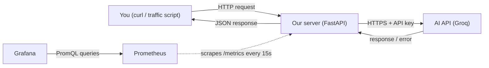

# Plan

A small server that calls an AI API, gets monitored by Prometheus, and is visualised in Grafana.
The goal is to **learn**: the flow, the concepts, and where each piece sits in the code. The product itself comes second.

## The three features



| # | Feature | What you'll be able to explain afterwards |
|---|---|---|
| 1 | **AI API server**: the server holds the API key, calls the AI API, and returns success or failure | Request/response cycle, secrets handling, timeouts, retries, error mapping |
| 2 | **Prometheus monitoring**: the server exposes metrics, and Prometheus scrapes and stores them | Metric types, labels, the pull model, PromQL, cardinality |
| 3 | **Grafana dashboard**: KPIs built on top of Prometheus data, plus how to read insights from them | Datasources, panels, dashboards as code, reading the KPIs |

> Note: Grafana is **not** a database. Prometheus *is* the time-series database; Grafana only queries it and draws the results. This is a classic interview question.

## Tech choices

| Piece | Choice | Why |
|---|---|---|
| Language / server | Python + FastAPI | Simple, async, auto docs at `/docs` |
| AI API | Groq (`groq` SDK): free tier, no card, open-source models. Two tiers: **light** `openai/gpt-oss-20b` and **heavy** `openai/gpt-oss-120b` | Swappable: the whole AI call lives in one file |
| Fake mode | `AI_PROVIDER=fake` | Lets us learn and test without using free-tier quota or needing a key |
| API docs | **Swagger UI**, built into FastAPI at `/docs` (generated from our routes and Pydantic models; ReDoc at `/redoc`) | Documentation that cannot go out of date, plus a place to try every endpoint |
| Metrics SDK | `prometheus_client` (official Python client) | The standard way to instrument a Python service |
| Prometheus + Grafana | Docker Compose | One command to start everything |

## Target layout (grows part by part)

```
app/
  main.py         # Part 1: FastAPI app + routes
  config.py       # Part 1: reads settings and the API key from .env
  ai_client.py    # Part 1: the ONLY file that talks to the AI API
  model_selector.py  # Part 1: job -> tier -> model name (classify=light, analyze=heavy)
  errors.py       # Part 1: our one JSON error shape (404, 405, AI errors)
  metrics.py      # Part 2: metric definitions
tests/            # Part 1+: tests run in fake mode
monitoring/
  prometheus.yml  # Part 2: what to scrape and how often
  grafana/        # Part 3: datasource + dashboard provisioning (dashboards as code)
scripts/
  traffic.py      # Part 3: generates mixed traffic so the dashboard shows something
docker-compose.yml
```

## How every part works

Each part follows the same loop:

1. **Implement**: small steps, each one runnable.
2. **Run it and break it**: wrong key, timeout, API down, and so on.
3. **Learn**: the flow, the architecture, and where it lives in the code (notes go in [LEARNING.md](LEARNING.md)).
4. **Discuss**: you ask questions and we go deeper wherever it's unclear.
5. **Interview check**: 10–15 interview questions on the part (hands-on and concepts), answered in your own words.
6. Tick it off in [PROGRESS.md](PROGRESS.md), commit, and move on.

---

## Part 1: AI API server

**Goal:** two job endpoints, `POST /classify` (always the **light** model) and `POST /analyze` (always the **heavy** model). The server adds the API key, calls the AI API, and returns the result, or a clear failure.

| Step | What | Done when |
|---|---|---|
| 1.1 | Project skeleton: venv, FastAPI, `GET /health`, first test | `curl localhost:8000/health` → `{"status":"ok"}` |
| 1.2 | Config and secrets: `.env`, `config.py`, key never logged or returned, plus a custom JSON 404/405 | Server refuses to start in real mode without a key |
| 1.3 | `ai_client.py`: one Groq client created once and reused, the model and parameters passed per call, plus fake mode. Verify the model name with `GET /models` | a fake (then real) call works from the model client |
| 1.4 | **Job endpoints and model selection**: `routes/classify.py` (light) and `routes/analyze.py` (heavy). Each endpoint has its own job prompt and token cap. `model_selector.py` maps job → tier → model name from `.env`. This replaces the temporary `/ask` stub | `POST /classify` and `POST /analyze` use different models, and the response says which |
| 1.5 | Failure handling: timeout, bad key (401), rate limit (429), upstream 5xx → clean JSON errors with sensible HTTP codes | Each failure is reproducible by hand |
| 1.6 | Tests in fake mode (including routing and each failure) | `pytest` passes |
| 1.7 | **Document the API with Swagger UI**: summaries and descriptions on routes, tag descriptions, example request and response bodies, and the error responses (`responses={...}`) for 400/429/502/504 | Someone who never saw the code can use every endpoint from `/docs` |

**Concepts:** Swagger UI / OpenAPI · async vs sync request handling · custom error handlers · light vs heavy model routing (cost, speed, quality trade-off, why real systems do it) · HTTP request/response lifecycle · why the key stays on the server · env vars vs hard-coded secrets · sync vs async calls · timeouts and retries with backoff · mapping upstream errors to our status codes (502/503/504) · tokens and cost.

---

## Part 2: Prometheus monitoring

**Goal:** every AI call is measured, and Prometheus collects it.

| Step | What | Done when |
|---|---|---|
| 2.1 | Install `prometheus_client`, expose `GET /metrics` | You can read raw metrics text in the browser |
| 2.2 | Define metrics in `metrics.py` (table below) and record them in the code paths | Numbers move when you call `/classify` or `/analyze` |
| 2.3 | Run Prometheus in Docker and scrape the server | Target shows **UP** at `localhost:9090/targets` |
| 2.4 | PromQL basics in the UI and the CLI (`curl` the HTTP API, `promtool`) | You can answer "how many failures in the last 5 min?" |
| 2.5 | Logs vs metrics: add simple structured (JSON) logs and see what each one is for | You can explain when to use which |

Planned metrics:

| Metric | Type | Labels | Answers |
|---|---|---|---|
| `ai_requests_total` | Counter | `tier` = light / heavy, `outcome` = success / timeout / auth_error / rate_limited / upstream_error | How many calls, and how did they end? |
| `ai_request_duration_seconds` | Histogram | `tier`, `outcome` | How slow is the AI API? |
| `ai_tokens_total` | Counter | `tier`, `type` = input / output | How much are we using, and what does it cost? |
| `ai_requests_in_flight` | Gauge | none | How many calls are happening right now? |
| `http_requests_total` | Counter | `route`, `status` | How is our own server doing? |

**Concepts:** pull vs push · counter vs gauge vs histogram vs summary · labels and high cardinality (why the prompt text must **never** be a label) · scrape interval · `rate()`, `sum by`, `histogram_quantile()` · where metrics get recorded in the code (decorators, middleware, try/finally).

---

## Part 3: Grafana dashboard and insights

**Goal:** one dashboard that answers "is our AI feature healthy, fast, and affordable?"

| Step | What | Done when |
|---|---|---|
| 3.1 | Grafana in Docker Compose, Prometheus datasource (first by hand in the UI, then provisioned from a file) | Grafana's Explore view shows our metrics |
| 3.2 | Build the KPI panels by hand in the UI | Dashboard shows live data |
| 3.3 | Export the dashboard to JSON and provision it from `monitoring/grafana/` (dashboards as code) | `docker compose down -v && up` brings the dashboard back |
| 3.4 | Grafana CLI and HTTP API: list dashboards, check health, and so on | You can manage Grafana without the UI |
| 3.5 | `scripts/traffic.py` generates mixed traffic (successes plus injected failures) | Graphs show realistic patterns |
| 3.6 | **Insights exercise**: read the dashboard and write 3–5 findings | Findings written in LEARNING.md |

KPI panels:

| KPI | PromQL idea |
|---|---|
| Success rate % | `sum(rate(ai_requests_total{outcome="success"}[5m])) / sum(rate(ai_requests_total[5m]))` |
| Error rate by reason | `sum by (outcome) (rate(ai_requests_total{outcome!="success"}[5m]))` |
| p50 / p95 latency | `histogram_quantile(0.95, sum by (le) (rate(ai_request_duration_seconds_bucket[5m])))` |
| Throughput (req/s) | `sum(rate(ai_requests_total[1m]))` |
| Latency and cost: light vs heavy | same queries, `sum by (tier)` |
| Tokens per minute | `sum by (type) (rate(ai_tokens_total[5m])) * 60` |
| Estimated cost per hour | tokens rate × price per token |
| In-flight requests | `ai_requests_in_flight` |

**Concepts:** Grafana vs Prometheus roles · datasource · panel types (time series, stat, gauge) · dashboard variables · provisioning · reading a dashboard: spotting a latency spike, connecting errors to latency, cost trends.

---

## Later (only if you want)

Alerts (Prometheus rules + Alertmanager) · logs in Grafana (Loki) · SLOs and error budgets · CI with GitHub Actions.
