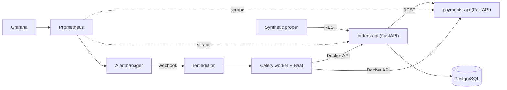

# Reliability Platform

A small, local, end-to-end **site reliability** platform: it detects failures automatically, measures reliability against SLOs, and fixes common failures with zero manual steps.

> **Status: work in progress.** Built feature by feature, one branch and pull request each. See the [roadmap](#roadmap).

## What it demonstrates

- **SLIs, SLOs, error budgets, burn-rate alerting** with Prometheus, Alertmanager and Grafana
- **Structured logging** with a request ID that follows a request across services
- **Availability monitoring**: health checks, `up`, and a synthetic prober that behaves like a user
- **Zero-touch remediation**: webhook → runbook strategy → Celery task → verify → escalate, with attempt limits and cooldowns
- **Monitored scheduled jobs** (Celery Beat): a cron job that silently stops is an incident
- **Incident response**: incident records, measured MTTD / MTTR, auto-generated incident reports

## Architecture

Full details, design decisions and the reasoning behind them: [docs/PLAN.md](docs/PLAN.md).

## SLOs

| SLI | Target |
|---|---|
| orders-api availability | 99.9% over 30 days (≈ 43 min error budget) |
| orders-api latency | 95% of requests under 300 ms |

## Roadmap

| # | Feature | Branch | Status |
|---|---|---|---|
| 0 | Repo foundation, plan, learning log | `main` | ✅ |
| 1 | Services, Postgres, health checks, JSON logs, Compose | `feat/services` | ⬜ |
| 2 | CI | `chore/ci` | ⬜ |
| 3 | Metrics + dashboards | `feat/metrics` | ⬜ |
| 4 | SLO rules + alerting | `feat/slo-alerts` | ⬜ |
| 5 | Remediator + Celery | `feat/remediator` | ⬜ |
| 6 | Scheduled jobs + job monitoring | `feat/scheduled-jobs` | ⬜ |
| 7 | Chaos + incident records (MTTD/MTTR) | `feat/chaos-incidents` | ⬜ |
| 8 | Synthetic prober | `feat/synthetic-prober` | ⬜ |
| 9 | Results + demo | `docs/results` | ⬜ |

## Running it

Not runnable end-to-end yet. Each feature PR adds its own run instructions here.

Configuration lives in a local `.env` (copy `.env.example`). `.env` is git-ignored; never commit secrets.

## Learning log

This repo doubles as a study project. Concept notes live in [docs/learning/](docs/learning/) and progress is tracked in [docs/LEARNING.md](docs/LEARNING.md).

## License

MIT
