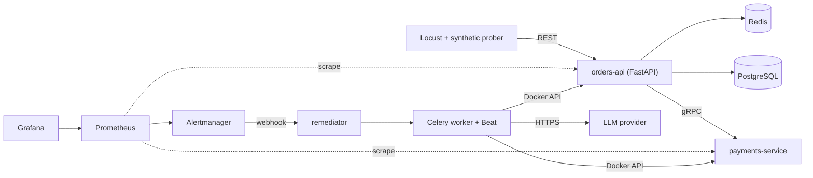

# Reliability Platform

A small, local, end-to-end **site reliability** platform: it detects failures automatically, measures reliability against SLOs, fixes common failures with zero manual steps, and uses an LLM to help with triage and post-incident reviews, under strict guardrails.

> **Status: work in progress.** Built feature by feature, one branch and pull request each. See the [roadmap](#roadmap).

## What it demonstrates

- **SLIs, SLOs, error budgets, burn-rate alerting** with Prometheus, Alertmanager and Grafana
- **Zero-touch remediation**: webhook → runbook strategy → Celery task → verify → escalate, with attempt limits and cooldowns
- **gRPC** between internal services, contract-first with Protocol Buffers
- **Monitored scheduled jobs** (Celery Beat): a cron job that silently stops is an incident
- **Redis** caching and rate limiting
- **AI-assisted operations** (LangChain): draft post-incident reviews and triage unknown alerts; *AI proposes, deterministic code disposes*
- **Chaos testing and measured MTTD / MTTR**, **load testing** and capacity findings
- **CI/CD** with GitHub Actions

## Architecture

Full details, design decisions and the reasoning behind them: [docs/PLAN.md](docs/PLAN.md).

## SLOs

| SLI | Target |
|---|---|
| orders-api availability | 99.9% over 30 days (≈ 43 min error budget) |
| orders-api latency | 95% of requests under 300 ms |

## Roadmap

| # | Feature | Branch | Status |
|---|---|---|---|
| 0 | Repo foundation, plan, learning log | `main` | ✅ |
| 1 | Protobuf contract + compile step | `feat/proto-contract` | 🚧 |
| 2 | Services (REST + gRPC), Postgres, Compose | `feat/services` | ⬜ |
| 3 | CI | `chore/ci` | ⬜ |
| 4 | Redis cache + rate limiter | `feat/redis-cache-ratelimit` | ⬜ |
| 5 | Metrics + dashboards | `feat/metrics` | ⬜ |
| 6 | SLO rules + alerting | `feat/slo-alerts` | ⬜ |
| 7 | Remediator + Celery | `feat/remediator` | ⬜ |
| 8 | Scheduled jobs + job monitoring | `feat/scheduled-jobs` | ⬜ |
| 9 | Chaos + incident records (MTTD/MTTR) | `feat/chaos-incidents` | ⬜ |
| 10 | AI post-incident reviews | `feat/ai-postmortem` | ⬜ |
| 11 | AI alert triage | `feat/ai-triage` | ⬜ |
| 12 | Synthetic prober | `feat/synthetic-prober` | ⬜ |
| 13 | Load testing + capacity | `feat/load-testing` | ⬜ |
| 14 | Results + demo | `docs/results` | ⬜ |

## Running it

Not runnable end-to-end yet. Each feature PR adds its own run instructions here.

Configuration lives in a local `.env` (copy `.env.example`). `.env` is git-ignored; never commit keys.

## Learning log

This repo doubles as a study project. Concept notes live in [docs/learning/](docs/learning/) and progress is tracked in [docs/LEARNING.md](docs/LEARNING.md).

## License

MIT
