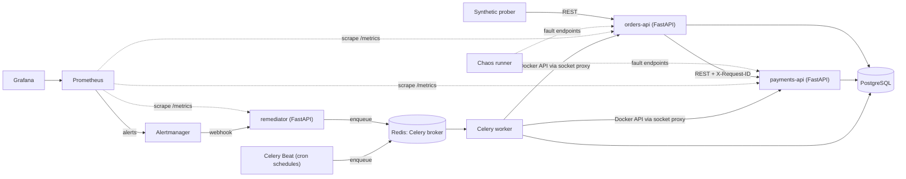

# Project Plan

Goal: **detect failures automatically, measure reliability against SLOs, and fix common failures with zero manual steps.**

Scope is deliberately limited to these skills, and every one is demonstrated by something you can run:

| Skill | Where it shows up |
|---|---|
| Prometheus | metrics from every service, recording rules, alert rules |
| Grafana | golden-signals and SLO / error-budget dashboards |
| Logging | structured JSON logs with a request ID that follows a request across services |
| Alerting | burn-rate alerts through Alertmanager |
| SLOs / SLIs | availability and latency SLOs, error-budget tracking |
| Availability monitoring | health checks, `up`, and a synthetic prober that acts like a user |
| Incident response | incident records, MTTD / MTTR, auto-generated incident reports |
| Operational task automation | the remediator: alert → runbook → action → verify → escalate |
| Python scripting | chaos runner, report generator, rule generator |
| Celery | remediation and verification tasks |
| Scheduled jobs (cron) | Celery Beat schedules, including **monitoring of the jobs themselves** |
| Webhooks | Alertmanager → remediator (inbound), escalation notice (outbound) |

## 1. Architecture

Every arrow is a different communication style on purpose. See [learning/00-how-services-talk.md](learning/00-how-services-talk.md).

**Why two services:** orders-api depends on payments-api, which produces realistic failures. If payments is slow, orders becomes slow too, and you can show how to find which service is really at fault.

## 2. Design decisions and the bugs they fix

The first draft of this plan had these problems. Each is fixed here, and most have a test.

| # | Problem | Decision |
|---|---|---|
| 1 | The latency SLI queries `le="0.3"`, but typical buckets (0.05 → 5s) have no 0.3 boundary, so the query returns nothing. | Buckets explicitly include 0.3: `0.05, 0.1, 0.2, 0.3, 0.5, 1, 2, 5`. A test asserts it. |
| 2 | Chaos "crash" plus Docker `restart: unless-stopped` means Docker fixes it before the remediator acts, so MTTR would measure Docker, not our automation. | Services run with `restart: "no"` in the demo. The remediator is the only thing that restarts them. |
| 3 | Dedupe "same fingerprint already handled → ignore" also ignores a *new* incident with the same labels after the old one resolved. | Dedupe key = fingerprint **while an incident is open**. A `resolved` webhook closes it. |
| 4 | "FastBurn caused by payments → restart payments" needs a diagnosis step that was never defined. | Add a **Diagnose** step: query dependency failure ratios in Prometheus. |
| 5 | "Wait 60s then verify" inside a Celery task blocks a worker. | Verify is a separate task scheduled with `countdown=60`. |
| 6 | The availability SLI is empty at zero traffic, so a total outage with no traffic fires nothing. | `up == 0` and the synthetic prober cover the zero-traffic case. Documented and tested. |
| 7 | "DB connection exhaustion" is in the results table but no fault produces it. | Add a `hold-db-connections` fault endpoint. |
| 8 | Mounting `/var/run/docker.sock` into the remediator gives it root on the host. | Use a docker-socket-proxy that only allows container restart, plus a container-name allowlist. |
| 9 | Cron-style jobs were only mentioned in passing. | Celery Beat jobs with **job-run monitoring** and a "job did not run" alert. |
| 10 | DEMO_MODE "shrinks windows", but Prometheus rule files are static. | Rules are **generated** from `monitoring/slos.yaml` by a small script. DEMO_MODE is a parameter to the generator. |

## 3. SLOs

| SLI | Target | Window | Error budget |
|---|---|---|---|
| orders-api availability (non-5xx ÷ total) | 99.9% | 30 days | ≈ 43.2 min of full downtime |
| orders-api latency (share of requests < 300 ms) | 95% | 30 days | 5% of requests may be slower |
| Scheduled-job freshness (last success younger than 2× interval) | every run on time | rolling | any miss alerts |

Alerting is on **burn rate** over two windows (a fast and a slow one), following the Google SRE workbook.

| Alert | Condition | Severity | Action |
|---|---|---|---|
| FastBurn | burn > 14.4 over 5m **and** 1h | critical | auto-remediate, then page |
| SlowBurn | burn > 6 over 30m **and** 6h | warning | open incident, no page |
| ServiceDown | `up == 0` for 1m | critical | auto-restart |
| HighLatency | latency SLI < 95% for 5m | warning | diagnose, then act |
| ProbeFailing | probe fails 3× in a row | critical | auto-restart |
| ScheduledJobMissed | `time() - job_last_success > 2 × interval` | warning | open incident, escalate |

## 4. Remediation flow

1. **Receive** the Alertmanager webhook (`alertname`, `service`, `fingerprint`, `status`).
2. **Deduplicate**: ignore if an incident for this fingerprint is open. Close it on `resolved`.
3. **Diagnose**: deterministic checks against Prometheus (which dependency is failing?).
4. **Choose runbook**: `alertname` plus diagnosis → strategy (`RestartContainer`, `KillIdleDbConnections`, `Escalate`).
5. **Guardrails**: ≤ 3 attempts per 15 minutes, cooldown, container allowlist. Failing a guardrail means Escalate.
6. **Act**: a Celery task runs the action through the Docker API.
7. **Verify**: a delayed task re-queries the SLI after 60s. Recovered → mitigated. Not recovered → retry or escalate.

Anything unknown does nothing automatically and escalates to a human. Escalation posts to a configurable webhook URL (default: log only).

## 5. Scheduled jobs

Celery Beat runs cron-style schedules:

| Job | Schedule | What it does |
|---|---|---|
| `stale_incident_sweeper` | every 5 minutes | Finds incidents stuck open past a threshold and escalates them. |
| `slo_daily_digest` | daily | Computes error budget remaining and stores it. |
| `prune_old_incidents` | weekly | Housekeeping. |

Every job records a `job_runs` row (start, end, status) and exports `job_last_success_timestamp_seconds{job}` and `job_duration_seconds{job}`. The **ScheduledJobMissed** alert catches jobs that silently stopped, which is the classic failure of cron.

## 6. Incident records and reports

`incidents`: `id, service, alertname, detected_at, mitigated_at, resolved_at, actions_taken, attempts, escalated`

- **MTTD** = alert fired − failure injected
- **MTTR** = resolved − detected
- **Auto-fix rate** = mitigated without escalation ÷ total

After each chaos run, a script generates a Markdown incident report: timeline, actions taken, relevant logs (pulled by service and time window), and the fix.

## 7. Roadmap (one branch per feature, one PR each)

| # | Branch | Deliverable | Done when |
|---|---|---|---|
| 0 | `main` | Repo, README, plan, learning log | repo is public |
| 1 | `feat/services` | orders-api + payments-api (FastAPI) + Postgres, `/health/live` and `/health/ready`, JSON logs, request-ID propagation, docker-compose | one request shows the same `request_id` in both services' logs |
| 2 | `chore/ci` | GitHub Actions: ruff, pytest, image build | green CI badge |
| 3 | `feat/metrics` | shared metrics middleware, Prometheus scraping, Grafana golden signals | traffic moves the graphs |
| 4 | `feat/slo-alerts` | `slos.yaml` → generated recording and alert rules, Alertmanager, `promtool` check in CI, SLO dashboard panel | stopping payments fires an alert |
| 5 | `feat/remediator` | webhook receiver, dedupe, strategies, Celery worker, guardrails, delayed verify, socket proxy | killing payments gets it restarted automatically |
| 6 | `feat/scheduled-jobs` | Celery Beat, the three jobs above, job-run monitoring | pausing Beat fires ScheduledJobMissed |
| 7 | `feat/chaos-incidents` | fault endpoints, chaos runner, incidents table, MTTD / MTTR, report generator | one chaos run produces a measured report |
| 8 | `feat/synthetic-prober` | prober, `probe_success`, ProbeFailing alert and panel | breaking the payment flow fires ProbeFailing while `up == 1` |
| 9 | `docs/results` | README results table, screenshots, 2-minute demo video | a stranger runs it in 5 minutes |

About nine sessions of roughly two hours.

## 8. Out of scope

Anything not in the skills table above, including ETL, gRPC, Redis caching and rate limiting, load testing, LLM features, cloud deployment and Kubernetes. They can be added later as separate branches, but they are not part of this project's definition of done.
