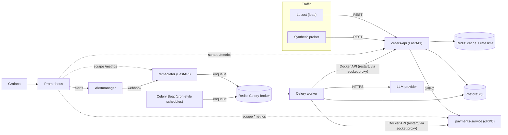

# Project Plan (v2)

Goal: **detect failures automatically, measure reliability against SLOs, fix common failures with zero manual steps, and use AI where it genuinely helps (triage and post-incident reviews) without ever letting it act unsupervised.**

v1 of this plan was a Prometheus + Alertmanager + Celery remediation platform. v2 keeps that core and adds four things v1 was missing: **gRPC** between services, **scheduled jobs that are themselves monitored**, **Redis caching and rate limiting**, and **LLM-assisted incident work**. Section 2 explains every change.

## 1. Architecture

Every arrow is a different communication style on purpose. See [docs/learning/00-how-services-talk.md](learning/00-how-services-talk.md).

## 2. What changed from v1, and why

| # | Finding in v1 | Change in v2 |
|---|---|---|
| 1 | **Bug:** latency SLI queries `le="0.3"`, but the planned buckets (0.05 → 5s) usually lack a 0.3 boundary, so the query returns nothing. | Histogram buckets explicitly include 0.3: `0.05, 0.1, 0.2, 0.3, 0.5, 1, 2, 5`. A test asserts it. |
| 2 | **Bug:** chaos "crash" fault plus Docker `restart: unless-stopped` means Docker fixes it before the remediator acts, so MTTR measures Docker, not our automation. | Services run with `restart: "no"` in the demo; the remediator is the only thing that restarts them. |
| 3 | Dedupe "same fingerprint already handled → ignore" would also ignore a *new* incident with the same labels after the old one resolved. | Dedupe key = fingerprint **while an incident is open**. A `resolved` webhook closes it. |
| 4 | "FastBurn caused by payments → restart payments" needs a *diagnosis* step that v1 never defined. | Remediation flow gains a **Diagnose** step (query dependency failure ratios in Prometheus). |
| 5 | "Wait 60s then verify" inside a Celery task blocks a worker. | Verify is a separate task scheduled with `countdown=60`. |
| 6 | Availability SLI is `NaN` when there is zero traffic, so a total outage with no traffic fires nothing. | `up == 0` and the synthetic prober cover the zero-traffic case; documented and tested. |
| 7 | "DB connection exhaustion" appears in the results table but no fault produces it. | Add a `hold-db-connections` fault endpoint. |
| 8 | Mounting `/var/run/docker.sock` into the remediator gives it root on the host. | Use a docker-socket-proxy that only allows container restart, plus a container-name allowlist. |
| 9 | "Clear Redis cache" remediation had no cache to clear; "Redis rate limiting" and "caching" were not demonstrated anywhere. | orders-api gets a Redis cache-aside layer and a per-IP rate limiter. |
| 10 | No scheduled-job coverage beyond the 15s prober. | Celery Beat jobs (nightly ETL rollup, daily SLO digest) with **job-run monitoring** and a "job did not run" alert. |
| 11 | DEMO_MODE "shrinks windows" but Prometheus rule files are static. | Rules are **generated** from `monitoring/slos.yaml` by a small script; DEMO_MODE is a parameter to the generator. |
| 12 | Internal call was plain HTTP, giving no exposure to contract-first RPC. | orders-api → payments is **gRPC** (`proto/payments/v1/payments.proto`). |
| 13 | No AI component. | LLM post-incident reviews and LLM triage of unknown alerts, behind strict guardrails. |

## 3. SLOs

| SLI | Target | Window | Error budget |
|---|---|---|---|
| orders-api availability (non-5xx ÷ total) | 99.9% | 30 days | ≈ 43.2 min of full downtime |
| orders-api latency (share of requests < 300 ms) | 95% | 30 days | 5% of requests may be slower |
| Scheduled-job freshness (last success age < 2× interval) | 100% of runs on time | rolling | any miss alerts |

Alerting is on **burn rate** over two windows (fast and slow) per the Google SRE workbook:

| Alert | Condition | Severity | Action |
|---|---|---|---|
| FastBurn | burn > 14.4 over 5m **and** 1h | critical | auto-remediate, then page |
| SlowBurn | burn > 6 over 30m **and** 6h | warning | open incident, no page |
| ServiceDown | `up == 0` for 1m | critical | auto-restart |
| HighLatency | latency SLI < 95% for 5m | warning | diagnose, then act |
| ProbeFailing | probe fails 3× in a row | critical | auto-restart |
| ScheduledJobMissed | `time() - job_last_success > 2 × interval` | warning | open incident, escalate |

## 4. Remediation flow

1. **Receive** Alertmanager webhook (`alertname`, `service`, `fingerprint`, `status`).
2. **Deduplicate**: ignore if an incident for this fingerprint is open; close it on `resolved`.
3. **Diagnose**: deterministic checks against Prometheus (which dependency is failing?).
4. **Choose runbook**: `alertname` + diagnosis → strategy (RestartContainer, ClearCache, KillIdleDbConnections, Escalate).
   Unknown alerts go to **AI triage**, which may only pick from the same allowlist.
5. **Guardrails**: ≤ 3 attempts per 15 min, cooldown, service allowlist. Fail → Escalate.
6. **Act**: Celery task, via Docker API.
7. **Verify**: delayed task re-queries the SLI after 60s. Recovered → mitigated. Not → retry or escalate.

## 5. AI components

Principle: **AI proposes, deterministic code disposes.** The model never executes anything.

| Component | What it does | Guardrails |
|---|---|---|
| Post-incident review (PIR) writer | Builds a blameless review (timeline, impact, root cause hypothesis, remediation recommendations) from the incident record, alert history, metric snapshots, and logs. | Output is a *draft*; every claim must cite a timeline entry; run once per incident. |
| Alert triage | For alerts with no runbook, suggests a diagnosis and one action. | Structured output, action is an **enum of the allowlist**; same attempt limits as any strategy; timeouts and errors fall back to Escalate. |
| LLM observability | `llm_request_duration_seconds`, `llm_tokens_total`, `llm_errors_total` | The AI component has its own SLIs; call budget per hour. |

Other design rules:
- Provider-agnostic through LangChain (`init_chat_model`); provider/model come from `.env`.
- A **fake LLM** is the default in tests and CI, so CI never needs an API key or spends money.
- Logs and alert labels are **untrusted input** (prompt-injection surface). They are passed as delimited data, and the enum-only output limits the blast radius.
- Runbooks live in `docs/runbooks/` as Markdown. They are human documentation *and* the context given to the triage model (retrieval without a vector DB; with a handful of runbooks, embeddings would be over-engineering).

## 6. Scheduled jobs

Celery Beat runs cron-style schedules:

| Job | Schedule | Purpose |
|---|---|---|
| `orders_daily_rollup` | nightly | ETL: aggregate orders into a summary table |
| `slo_daily_digest` | daily | compute budget remaining, store, optionally notify |
| `prune_old_incidents` | weekly | housekeeping |

Every job records `job_runs` (start, end, status) and exports `job_last_success_timestamp_seconds{job}` and `job_duration_seconds{job}`. The **ScheduledJobMissed** alert catches jobs that silently stopped, the classic failure of cron.

## 7. Roadmap (one branch per feature, one PR each)

| # | Branch | Deliverable | Done when |
|---|---|---|---|
| 0 | `main` | Repo, README, plan, learning log | repo is public |
| 1 | `feat/proto-contract` | `payments.proto`, compile step, contract test | generated stubs import and round-trip a message |
| 2 | `feat/services` | orders-api (REST) + payments-service (gRPC) + Postgres, health, JSON logs, request-ID in gRPC metadata, docker-compose | one request shows the same `request_id` in both services' logs |
| 3 | `chore/ci` | GitHub Actions: lint, pytest, proto compile, image build | green CI badge |
| 4 | `feat/redis-cache-ratelimit` | cache-aside reads, per-IP rate limiter | repeat GET is a cache hit; burst gets HTTP 429 |
| 5 | `feat/metrics` | HTTP middleware + gRPC interceptors, Prometheus, Grafana golden signals | traffic moves the graphs |
| 6 | `feat/slo-alerts` | `slos.yaml` → generated rules, burn-rate alerts, Alertmanager, `promtool` in CI | stopping payments fires an alert |
| 7 | `feat/remediator` | webhook, dedupe, strategies, Celery, guardrails, delayed verify, socket proxy | killing payments gets it restarted automatically |
| 8 | `feat/scheduled-jobs` | Celery Beat jobs + job monitoring | pausing Beat fires ScheduledJobMissed |
| 9 | `feat/chaos-incidents` | fault endpoints, chaos runner, incidents table, MTTD/MTTR | one chaos run produces measured MTTD/MTTR |
| 10 | `feat/ai-postmortem` | LangChain PIR writer + fake LLM for tests | a chaos run produces a draft PIR automatically |
| 11 | `feat/ai-triage` | LLM triage for unknown alerts + LLM metrics | unknown alert → allowlisted action or escalation |
| 12 | `feat/synthetic-prober` | prober, `probe_success`, ProbeFailing | breaking the payment flow fires ProbeFailing while `up == 1` |
| 13 | `feat/load-testing` | Locust ramp, find and fix one bottleneck | "X req/s before, Y after fixing Z" |
| 14 | `docs/results` | README results, screenshots, demo video | a stranger runs it in 5 minutes |
| stretch | `feat/cloud-deploy` | deploy the compose stack to one AWS/GCP VM via GitHub Actions | stack reachable on a cloud VM |

Core path to a showable project is 1–10 plus 14. 11–13 are extensions.

## 8. Explicitly out of scope

- **LLM fine-tuning.** It needs a dataset and GPU time and does not fit a reliability platform honestly. LLM *integration*, prompt design, structured output, cost and latency control are in scope.
- **Cloud deployment** is a stretch goal (branch `feat/cloud-deploy`), not core.
- Kubernetes. Docker Compose is enough to demonstrate every concept here; the plan notes where K8s would differ.
